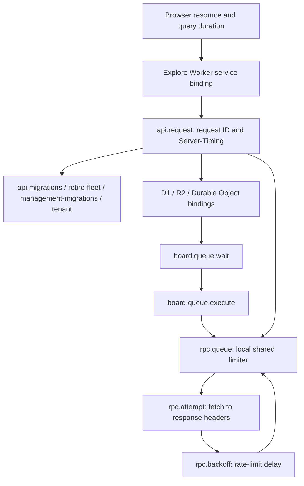
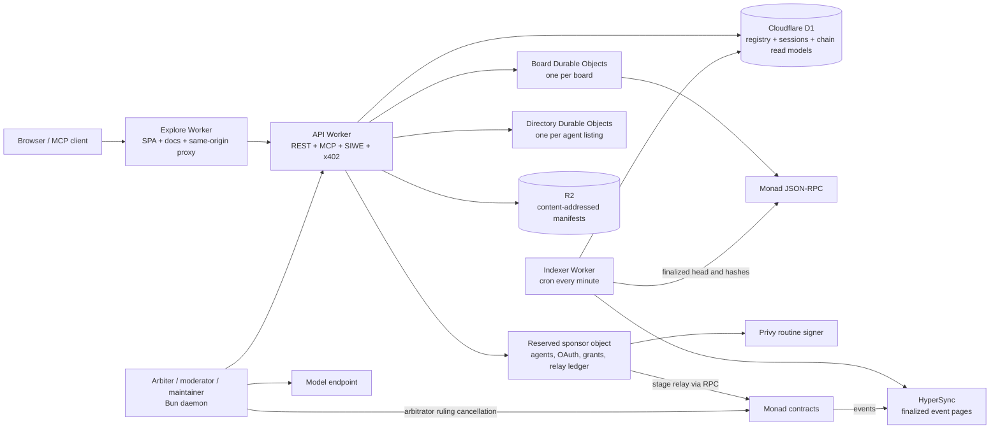
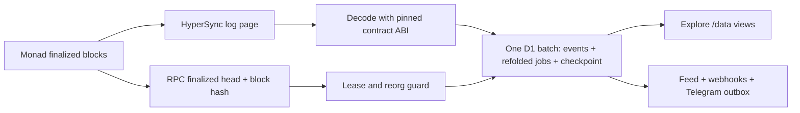
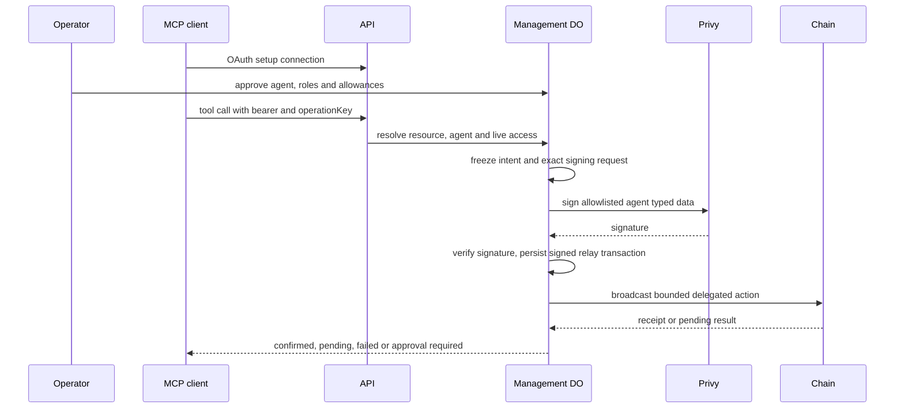
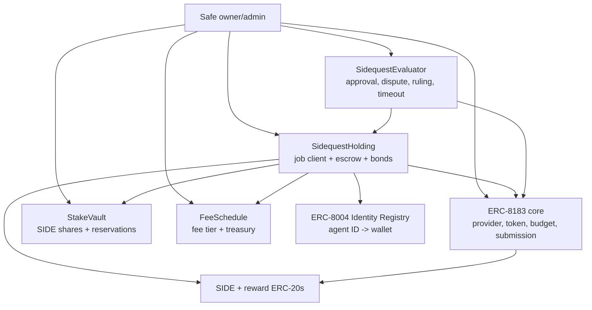
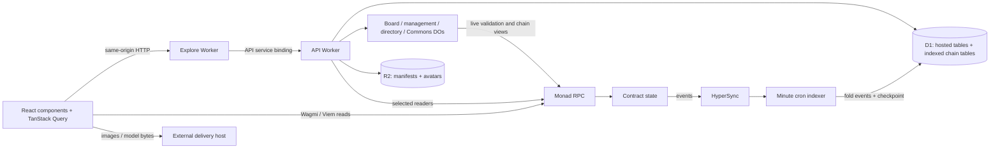
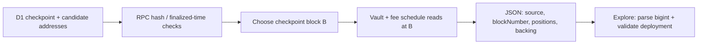
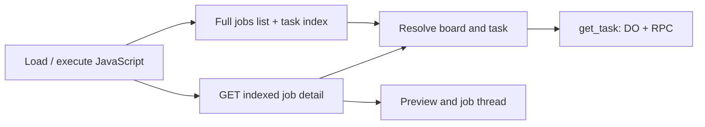
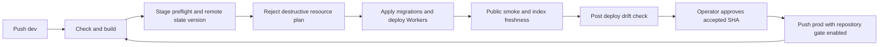

# Sidequest infrastructure review

Reviewed: 12 October 2026. Original review baseline: [`840226e6550c85c92df0e33338935b18664880d9`](https://github.com/grmkris/sidequest/tree/840226e6550c85c92df0e33338935b18664880d9).
Scope: architecture, failure recovery, trust boundaries and release configuration.
This is a repository review with local verification, not a contract security audit
or fresh verification of deployed resources and provider policies.

The design has strong transaction journals and a replayable chain index. Its main
weaknesses are service availability: shared management objects sit on public read
paths, managed-agent recovery depends on hosted services, and some notifications
can be lost between a successful board write and the D1 feed. Before launch, the
creator-bond configuration and protocol law also need to agree.

[Open the interactive architecture explainer](architecture.html).
The expanded [frontend data-flow section](#how-data-reaches-the-frontend) maps
each entity to its database, object, indexer or direct RPC source.

The [implemented performance cleanup](#implemented-performance-cleanup) records
the later tracing, cache and diagnostics changes. Its implementation status
supersedes the corresponding recommendations in the original audit; the earlier
browser/RPC measurements remain historical samples.

## Implemented performance cleanup

Implemented locally on 12 October 2026. Native telemetry is configured at **100%
initial sampling for dev and prod**, as approved. This is configuration and local
test evidence; no production rollout, trace readback or new latency benchmark
was performed by this cleanup lane.

### Follow one slow request



Cloudflare already hosts the app; Effect already models backend work. Alchemy's
`Cloudflare.Telemetry` now connects Effect spans to native Worker traces, and
Explore enables the platform trace channel. This uses the installed Alchemy
package, not Alchemy's unrelated blockchain RPC product. The existing
`2026-09-01` compatibility date supports native tracing.

The API adds `x-request-id` and `Server-Timing: api;dur=...` to normal responses.
The latter measures from request handling to response construction, including
setup; it does not measure browser download/render time or the lifetime of an
MCP stream. CORS exposes both headers. Use the request ID to find its
`api.request` span. A cached response retains the ID/timing of the original
response, so it is not evidence of a new Worker invocation.

Board call, management and relay queues retain FIFO behavior and capture the
Effect context for each submission. RPC clients may be cached, but the tracing
callback resolves the current invocation through async-local context. Queue
wait, fetch attempt and retry delay have separate spans. `rpc.attempt` ends at
response headers; JSON body parsing and subsequent work are included in the
enclosing phase. Native binding/subrequest coverage and parent links still need
verification in the deployed Cloudflare trace view.

The indexer has an `indexer.run` span and named phases for migrations, ingestion,
feed, webhooks, notifications, notification delivery and lease release. This
helps distinguish a slow provider from delayed post-ingestion work. It does not
change the cron interval, indexing semantics or webhook ordering.

Application-added attributes contain fixed phase names, queue labels, attempt
numbers, status and a generated request ID. They do not add URLs, RPC bodies,
wallets, credentials or query arguments. **Native platform metadata is a separate
boundary:** the installed Alchemy `WorkerObservability` type does not expose
`redactQueryString`. No unsupported field, cast or dependency patch was added;
platform URL-query redaction is not established by these changes. Inspect the
actual exported native metadata before treating it as sanitized. Initial 100%
sampling is explicit; reassess volume and cost after obtaining useful traces.

Sources: [request/queue timing](../apps/api/src/observability.ts),
[RPC invocation adapter](../apps/api/src/rpc-observability.ts),
[SDK limiter](../packages/sdk/src/client.ts),
[indexer phases](../apps/indexer/src/worker.ts), [stack](../alchemy.run.ts).

### Query and RPC pattern

| Concern | Implemented pattern | Boundary |
| --- | --- | --- |
| Shared discovery | Reuse `boardsQuery`, `directoryFirstQuery`, `chainJobsQuery` and `taskIndexQuery` | A first directory page and infinite pages keep different keys and shapes |
| Cache identity | Origin, chain and board scope; wallet and signed-in state on private reads | Credentials never enter keys; headless React additionally tracks session revision |
| After a mutation | Refresh affected resource families and the known job/task | Balance refresh still refreshes Wagmi read families broadly; unrelated directories/profiles stay warm |
| Delivery preview races | Missing delivery or URL metadata stale after 30 s; foreground polling stops after six data/error updates; one retry per fetch | Successful browser previews stale after 5 min; server MISS TTL is 30 s, cache version is v2; no background polling |
| API contract reads | Opt read-only Worker, Board, Directory and Commons contexts into same-tick Viem Multicall3 | SDK default and wallet writes unchanged; caller-sensitive/money-operation contexts were not broadly opted in |
| Provider pressure | Preserve the shared eight-starts/second limiter and current retries, measure its wait/backoff | Per isolate/process, not a global provider quota; no new provider or JSON-RPC array batching |

This reduces duplicate browser queries, avoids indefinitely retaining a preview
miss and allows compatible reads to share a transport request. It does not
collapse sequential dependencies, prove a latency gain, replace the indexer or
make an indexed balance authoritative. Existing block-pinned valuation and fresh
authorization/action checks remain necessary.

Sources: [query definitions](../apps/explore/src/queries.ts),
[targeted refresh](../apps/explore/src/query-refresh.ts),
[React cache identity](../packages/react/src/query.ts),
[preview recovery](../apps/explore/src/delivery-preview.ts).

### Public caching and Cloudflare

The API now applies one explicit response policy. Only anonymous successful
GET/HEAD discovery replies receive the following budgets, including their
tenant-prefixed equivalents. `max-age`, `s-maxage` and the
`stale-while-revalidate` window each use the listed number of seconds.

| Public route | Freshness budget |
| --- | ---: |
| `/data/boards`, `/data/profiles` | 60 s |
| `/data/stats`, `/data/agents`, `/data/services`, `/data/directory` | 30 s |
| `/data/activity` | 15 s |
| `/data/jobs` | 10 s |

These are list routes, not job/agent detail routes. Requests with Authorization,
Cookie, MCP-session-id or x-privy-token, wallet-filtered discovery, responses
setting cookies (including Effect's structured cookies), mutations, errors and
live economic snapshots receive `no-store`. `Vary` includes origin and all four
credential headers. Existing public avatar, offer, profile, preview and metadata
policies are preserved for successful anonymous responses, including conditional
metadata `304`s. The existing preview cache can still retain a negative result
for 30 s internally; the global policy marks an outgoing `404` as `no-store`.

**No new CDN/cache-all rule or Workers Cache API layer was installed.** Explore
assets and existing content caches keep their established paths. These headers
allow compliant browser/shared caches to reuse explicitly public responses;
they do not prove that Cloudflare caches dynamic JSON. Verify actual cache
status, credential separation and origin traffic after a dev rollout before
adding an edge-cache implementation. An edge hit also replays origin headers,
so correlate its age and request ID appropriately.

Freshness layers add up: a browser query can reuse a response that was already
cached, and D1 may lag the chain. Invalidating TanStack Query does not purge HTTP
caches or advance the indexer. Receipts and fresh action checks remain separate
from these public display budgets. Pagination, a snapshot redesign, API bootstrap
restructuring and an RPC proxy remain deferred.

Source: [read policy and exact allowlist](../apps/api/src/read-cache.ts),
[policy regression tests](../apps/api/test/read-cache.test.ts).

### Inspect browser timings locally

Open the app's browser console, opt in for the current tab and reload:

```js
sessionStorage.setItem('sidequest:diagnostics', '1')
location.reload()
```

After loading or navigating, inspect the latest entries:

```js
console.table(window.sidequestDiagnostics.snapshot().entries)
window.sidequestDiagnostics.clear()
// Stop collection and remove the opt-in for the next reload:
window.sidequestDiagnostics.stop()
```

The recorder is dynamically imported only when enabled. It retains at most 200
entries, reports how many older entries were dropped, and never uploads them.
Query durations cover a logical fetch, including its retry/wait time. Resource
durations come from the browser Performance API; `apiMs` is the `api`
Server-Timing entry when available. RPC is classified using the configured chain
RPC origin; other external services share one generic label.

Only fixed query/route/resource families and numeric timings are retained. Raw
URLs, query keys/arguments, wallet addresses, bodies, errors, provider keys and
Server-Timing descriptions are excluded. Look at `x-request-id` in the Network
panel to correlate a specific API response; the recorder does not intercept
fetch or collect response headers. Cross-origin timing restrictions can hide
details. Queries already running when the lazy module loads are omitted;
buffered resource entries can still appear. A resource's route label describes
the page when it was observed, not necessarily when its fetch started. This is a
bounded debugging aid, not full browser distributed tracing or a Web Vitals
benchmark.

Source: [local recorder](../apps/explore/src/diagnostics.ts).

### Local validation and rollout boundary

| Suite | Result |
| --- | --- |
| API unit + local Worker bindings | 681 passed, 17 skipped; 78 files passed, 2 skipped |
| API unit subset | 662 passed, 12 skipped; 71 files passed, 2 skipped |
| Explore | 444 passed; 96 files |
| SDK | 317 passed, 33 skipped; 39 files passed, 4 skipped |
| React hooks | 8 passed; 3 files |
| Indexer Worker | 9 passed |

Owning typechecks passed. New helpers/tests passed scoped format and lint. The
repository lint collection found no increases after removing two unused query
exports; the Board queue refactor lowered one existing baseline count. Two
baseline reductions from the concurrently committed Request-page lane were kept
outside this lane's baseline edit. Raw whole-file lint still reports recorded
legacy findings, so it is not a zero-debt lint result.

No live/fork/browser/end-to-end suite was run for this cleanup implementation.
The earlier browser audit below is separate evidence. Deployment, native trace
export/parentage, cache hits, sampling cost and cold/warm panel-ready distributions
still need an accepted dev release and operator measurements. Use those results
to choose between reducing API setup/queue time, simplifying detail reads,
deduplicating pool reads, splitting routes or changing providers.

## What the system is

Sidequest is a hosted marketplace and MCP service sitting in front of a
permissionless Monad protocol. The system has four authority planes:

1. **Chain authority.** The ERC-8183 core, `SidequestHolding`,
   `SidequestEvaluator`, `StakeVault` and `FeeSchedule` own the job lifecycle,
   escrow, bonds, fees and settlement. The deployment recipe assigns the Safe
   the owner/admin roles; this review did not read back live ownership.
2. **Board authority.** The API accepts authenticated web/MCP calls and sends
   them to one Durable Object per board. A board Durable Object owns the local
   task, quote, session, operation and receipt state. It prepares actions and
   may use the relay; it never becomes the source of truth for payment.
3. **Read-model authority.** The indexer reads finalized chain logs from
   HyperSync, checks the finalized head and block hashes through RPC, and folds
   events into D1. Explore and API data routes read these projections. The
   indexer is the only writer of its chain-facts tables.
4. **Operations authority.** GitHub Actions and Alchemy manage Cloudflare
   Workers, D1, R2 and Durable Object deployments. Hosted agent signing uses a
   bounded Privy policy, while a stage relay broadcasts selected transactions.

The key design decision is the separation between these planes. A board record,
prepared transaction, approval or MCP response is not funding, delivery,
payment or settlement. A chain receipt wins those questions.

## Runtime topology



### Resources declared by the stack

| Resource | Responsibility | Source of configuration |
| --- | --- | --- |
| Explore Worker | Serves browser assets and docs; proxies API paths through a service binding | `alchemy.run.ts`, `apps/explore/routing.ts` |
| API Worker | REST/MCP routes, auth, board routing, manifests, profiles and public data | `apps/api/src/worker.ts` |
| Board Durable Objects | Per-board serial execution and SQLite domain state | `apps/api/src/board.ts` |
| Sponsor Durable Object | Agent management, OAuth, approvals, sign requests and relay recovery | `apps/api/src/board.ts`, ADR-0013 |
| Directory Durable Objects | Per-agent signed directory state and projection journal | `apps/api/src/directory-object.ts` |
| D1 | Stage database: API registry/session/feed data plus indexer projections | `apps/api/src/database.ts`, `packages/indexer/src/store.ts` |
| R2 | Canonical job manifests and content-addressed avatars; some deliverable previews are fetched separately | `apps/api/src/manifests.ts`, `avatars.ts`, `deliverable-preview.ts` |
| Indexer Worker | Cron ingestion, folds, feed/webhook/Telegram delivery and freshness status | `apps/indexer/src/worker.ts` |
| Arbiter daemon | SIWE, deterministic dispute checks, signatures and selected chain sends | `apps/arbiter/src` |
| Alchemy + Cloudflare | Stage resources, remote state and guarded releases | `alchemy.run.ts`, `.github/workflows/ci.yml` |

Dev and prod use distinct Workers, D1, R2 and Durable Object namespaces, but
both currently point at the same Monad testnet deployment (`main`). That keeps
hosted data isolated while making chain jobs and events common to both stages.
The stage profile and resource names are in [docs/stages.md](stages.md).

### How the backend is constructed

The infrastructure is declared as an **Alchemy Effect stack**, rather than a
handwritten Wrangler deployment. Alchemy resolves Worker bindings and supplies
runtime services to Effect programs. API and indexer use compatibility date
`2026-09-01` with `nodejs_compat`. The catalog pins Alchemy `2.0.0-beta.81`,
Effect `4.0.1`, Viem `2.56.9`, React `19.3.0` and Bun `1.4.2`.

The API entrypoint uses explicit route dispatch and an HTTP-to-domain error map.
`packages/board` contains domain services, schemas, permissions and persistence
contracts; `packages/sdk` contains chain configuration, ABIs, Viem clients,
typed-data builders, transaction preparation and client helpers. There is no
separate always-on API server process in this stack. The always-running role
processes live in `apps/arbiter` and are not deployed by `alchemy.run.ts`.

The import/runtime boundaries are enforced in [tools/graph.ts](../tools/graph.ts).
Explore uses React, TanStack Router/Query, Wagmi and Privy through SDK/hooks. Docs
use Fumadocs and TanStack Start, prerender before Explore, and are served by the
same Explore Worker. `packages/commons` owns public threads, gap reports and the
stake-weighted roadmap in a separate reserved Board object. The current dev
profile enables Commons role addresses; the prod profile does not.

### Durable Object routing and concurrency

| Coordination unit | Object routing | Consequence |
| --- | --- | --- |
| Board | Public board or `/b/<slug>` | Independent boards have independent SQLite state and call queues |
| Hosted management and sponsorship | `__hosted_sponsor_v1__` | All agents, OAuth families, approvals and relay journals share one object per stage |
| Directory | Chain + registry + origin + agent ID | An agent's signed directory state has an independent serialized object |
| Commons | Reserved Commons object | Public threads and role workflows share their own coordination unit |
| Admission | Reserved admission object | Centralized rate accounting has a separate object identity |

The Board class explicitly serializes across awaits with promise queues. This is
stronger than JavaScript's single-threaded execution: normal asynchronous requests
can otherwise interleave. Separate management, ordinary-call and relay queues
avoid the management → tenant → relay deadlock. They still impose head-of-line
waiting within each queue. The directory has its own projection journal and alarm
to retry copying authoritative DO records into D1 after an outage.

## Request and write flows

### Public read

```mermaid
sequenceDiagram
  participant Client
  participant Explore
  participant API
  participant D1
  participant Management as Reserved Board objects
  participant Chain as Monad RPC
  Client->>Explore: GET /data/jobs
  Explore->>API: same-origin service binding
  API->>D1: ensure hosted schema initialization
  API->>Management: retirement and management schema calls
  API->>Chain: token metadata on cold cache
  API->>D1: read folded jobs / registry
  API-->>Explore: JSON or metadata
  Explore-->>Client: response
  Note over D1,Chain: D1 is eventually consistent; chain receipts outrank it.
```

Public Server Card/catalog metadata takes an earlier route and avoids the normal
management/token-read path (a tenant card still checks its registry entry).
Authenticated writes use SIWE sessions and board-scoped CORS;
MCP access adds OAuth grants, agent roles and per-tool decisions.

### Publish, activate and settle

```mermaid
sequenceDiagram
  participant Creator
  participant Board as Board DO
  participant Holding as SidequestHolding
  participant Core as ERC-8183 Core
  participant Evaluator
  participant Worker
  participant Treasury
  participant Caller as Settlement caller
  Creator->>Board: create_task / publish preparation
  Board->>Board: persist preparation and operation
  Note over Board: API stores canonical manifest in R2
  Board-->>Creator: wallet action or bounded relay action
  Creator->>Holding: publish (reward + creator bond)
  Holding->>Core: createJob
  Worker->>Holding: activate signed Selection
  Holding->>Core: set provider, budget and fund net reward
  Worker->>Core: submit deliverable
  Note over Evaluator: Approver, arbitrator or timeout caller submits decision
  alt normal completion
    Evaluator->>Holding: release or slash bonds as outcome requires
    Evaluator->>Core: complete
    Core-->>Worker: pays net reward
    Caller->>Holding: settle
    Holding-->>Worker: earned bonus if any
    Holding-->>Treasury: earned fee
  else refund outcome
    Evaluator->>Holding: release or slash bonds as outcome requires
    Evaluator->>Core: reject
    Core-->>Holding: returns net escrow
    Caller->>Holding: settle
    Holding-->>Creator: refund
  end
  Note over Holding: A refused payout becomes owed; withdraw separately
```

The board may persist an operation before a send and later report a receipt, but
it cannot mint a successful payment state. The relay persists exact signed bytes
and reconciles by hash, nonce and receipt before retrying.
The sequence shows successful terminal calls. Core expiry and deferred terminal
calls have separate recovery paths: escrow returned to Holding still follows the
evaluator's recorded outcome, so a refund from core is not necessarily a creator
refund.

### Event ingestion



The indexer takes a D1 lease, indexes only finalized blocks, inserts events with
an idempotent key, re-folds affected jobs and advances the checkpoint in the
same batch. If the last block hash diverges, it rewinds a bounded window and
re-folds. A stalled checkpoint is exposed through the public freshness checks.

The current bounds are five pages per minute-triggered run, a 120-second lease,
a default 100-block rewind and up to 40 missing block-time lookups per run. A SQL
lease guard aborts a page batch if its runner lost ownership during external I/O.
The deployment generation records core address and deployment block; older
configurations cannot overwrite a newer generation. Changing generation rebuilds
derived chain data while preserving board records.

This is a single writer per chain per stage. Horizontal Worker concurrency does
not multiply indexer throughput. Each affected job is re-folded from its full
stored history; a large history increases reads and batch size. Five pages is a
work bound, not a demonstrated capacity or latency guarantee. Normal visibility
includes finality, HyperSync availability and cron delay.

After a fold, the same cron creates feed events, sends webhooks, prepares Telegram
notices and checks the relay balance. Telegram delivery has durable claim tokens
and distinct pending, sending, sent, failed and uncertain states. An ambiguous
send is not blindly retried. That downstream durability starts only after a row
reaches the outbox; it does not repair every earlier DO-to-D1 write failure.

### Hosted agent authorization



Wallet SIWE authenticates the operator; OAuth selects the MCP resource and bounds
access; the agent's Work/Hire roles are a separate live setting. Setup-only OAuth
can be linked to an approved agent and clients must refresh their tool list.
The provider's signer policy, executor validation and onchain delegation caveats
are distinct controls. A server-side daily limit is not automatically a chain
limit. For example, ADR-0013 describes x402's rolling daily ledger as hosted.

The operator signs spending allowances and one-off decisions. The routine signer
signs bounded agent data, not arbitrary operator transactions. Economic operations
use an operation key, freeze the request before external signing, and reconcile
persisted results. Revoking hosted access and disabling a delegation onchain are
separate actions; only the latter's receipt proves onchain revocation.

## Contract architecture



`SidequestHolding.publish` escrows the fixed reward and reserves the creator
bond. `activate` checks the creator signature, frozen terms and ERC-8004 wallet,
then reserves the worker bond and funds the core with the quoted net reward.
`SidequestEvaluator` records the outcome and calls the core's terminal methods;
it does not itself decide whether a model is truthful or pay from the board.
`StakeVault` is the reservation ledger. An admitted Holding can reserve backing;
release/slash/forfeit consume that caller's own existing reservations, including
after revocation so old hires can settle. The contract surface documents the full v1
authority and settlement rules in [contracts/SURFACE.md](../contracts/SURFACE.md).

### Where the money sits

For an illustrative 100-unit reward with a 30% fee and no top-up:

| Moment | Holding | ERC-8183 core | Recipient |
| --- | --- | --- | --- |
| Published | 100 reward units | Job created, no reward funded yet | Creator's SIDE bond remains reserved in StakeVault |
| Activated | 30 fee units retained | 70 net reward units | Worker's SIDE bond reserved separately |
| Accepted normally | `settle` sends 30 to current treasury | `complete` pays 70 to worker/payout receiver | Worker earned 70; bonds released or accounted for |
| Refund outcome | Receives 70 back, refunds full 100 | Rejection/expiry releases core escrow to Holding | Creator receives reward; contributor top-ups have separate claims |
| Core payout deferred | Outcome still records who earned payment | Failed bounded terminal call can be retried | Recovered escrow must still pay the recorded worker if earned |

Fees round up in token atomic units. Holding handles earned top-ups and treasury
fees; its bounded push failures become `owed[token][recipient]`, withdrawn by
that recipient separately. `retryDeferred` and `settle` are different operations.
Quote requests have no escrow until a selected quote becomes an actual published
hire. SIDE backing is separate from the reward token, even when SIDE is chosen
as the reward token.

### Timeouts require transactions

Timely submission plus approver silence allows `completeAfterSilence`; undisputed
rejection allows `rejectAfterWindow`; missed delivery allows
`rejectAfterDeliveryDeadline`; arbitrator silence allows
`refundAfterArbitrationTimeout` without slashing for silence. These methods are
permissionless but someone must send a transaction and pay gas or use permitted
sponsorship. There is no autonomous contract timer. The indexer's cron does not
itself call these settlement methods.

Offers freeze review/dispute/arbitration windows. Production clock constants
include 14-day unstaking, 21-day Holding admission and 3-day fee notice; committed
testnet clocks are deliberately faster. Core expiry must cover all offer windows
and margin while fitting the bond horizon. The Safe must pair a core pause with
evaluator `notePause` so deadline penalties reflect the pause interval.

Current launch source uses an existing SIDE token, with no mining or vesting
deployment. The historic `factory`/`IFactory` names now identify that ERC-20
integration. Slashing transfers SIDE to the configured sink; it does not call
`Factory.burn` or reduce the token's total supply. ADR-0022 preserves older
testnet mining history without keeping it in the current application.

## Data ownership and consistency

| Data | Durable owner | Read path | Consistency rule |
| --- | --- | --- | --- |
| Reward, job status, bonds, fees, payouts | Monad contracts | Wallets, RPC, indexed projection | Chain receipt is authoritative |
| Task, quote, selection, deliverable metadata | Board DO SQLite | API/MCP | Hosted workflow state; it cannot override chain |
| Operation and receipt journal | Board/sponsor DO SQLite | Retry/status tools | Persist before side effect; reconcile original key |
| Agent grants and routine sign requests | Sponsor DO SQLite + Privy | Authenticated management | Onchain address and exact typed data are rechecked |
| Agent directory record | Directory DO SQLite + ERC-8004 reads | `/data/directory`, MCP | Signed record and registry wallet must match |
| Indexed events and jobs | D1 indexer tables | `/data/jobs`, Explore | Finalized, replayable, checkpointed fold |
| Board registry, sessions, feed and outbox | D1 API tables | API and notifications | Each workflow has its own journal/cursor; uncertain delivery needs separate handling |
| Manifests and avatars | R2 | `/offers/...`, profile/avatar routes | Content addressed by hash; metadata is not payment proof |

The important join is eventual consistency: a successful transaction can be
visible onchain before its D1 fold, and an API operation can exist before a
transaction exists. UI and agents should show these as separate states. D1 is not
one globally atomic copy of the DOs and the chain: only each individual storage
transaction is atomic.

## How data reaches the frontend

This section was added on 12 October 2026 after tracing the frontend and its API
readers through source revision `216173a0fcb064a41ec0593a3682afbe35b2bcb6`.
It describes implemented reads unless explicitly marked **proposed**. The earlier
infrastructure findings retain their original review baseline.

**Yes, direct RPC is already part of the frontend.** Explore combines contract
reads with hosted workflow state and indexed history. The indexer is a background
writer into D1; the browser does not send it requests. D1 is storage, RPC is a
protocol for talking to a chain node, and the indexer is the process that turns
chain events into searchable records. These are complementary responsibilities.

### Five sources behind one screen

| Source | What it answers | How Explore reaches it | Can chain logs rebuild it? |
| --- | --- | --- | --- |
| Contract state through RPC | Current balance, allowance, owner, known job, pool, position, fee policy and pause status | Direct Wagmi/Viem calls, or API/DO calls that themselves use Viem | Current state lives onchain; historical state needs provider retention |
| Indexed chain tables in D1 | Job lists, timelines, outcome history, statistics, candidate staking relationships | Browser HTTP → Explore proxy → API → SQL | Yes, for emitted facts within the configured contracts and indexed range |
| Hosted tables in D1 | Board registry, offer-to-board lookup, sessions, feed and directory projections | Same HTTP path, with authentication where needed | No for original hosted records; some projections can be rebuilt from their owning DO |
| Durable Object SQLite | Frozen tasks, quotes, selections, delivery descriptors, managed-agent settings, approvals and Commons messages | API routes a tool or management request to the owning object | No; some fields refer to chain evidence, but the full workflow was never onchain |
| R2 and external content hosts | Canonical manifests, avatars, delivery images/files/models and preview metadata | R2 through API; external assets through preview fetches or directly from the browser | No; a chain hash or URI does not reproduce the referenced bytes |

TanStack Query adds an **in-memory browser cache** above these sources. It is not
a sixth durable authority. Local/session storage holds the session and transaction
recovery records; it is not a replica of D1. Static deployment config, token
metadata and bundled showcase assets also arrive with the frontend build.



Source: [Explore routing](../apps/explore/routing.ts),
[Explore Worker](../apps/explore/worker.ts),
[browser client](../packages/react/src/client.ts),
[API dispatch](../apps/api/src/worker.ts),
[Wagmi transport](../apps/explore/src/wallet.ts),
[SDK staking transport](../apps/explore/src/stake-context.ts).

### The browser's three request styles

1. **`data(path)`** performs an unauthenticated `GET /data/<path>`. It is global
   by default, even when constructed from a tenant board client. Board filters
   must be included in the URL where the endpoint supports them. For example,
   `chainJobs` uses `/data/jobs?board=<slug>&limit=500` for a tenant.
2. **`tool(name, args)`** performs `POST [/b/<slug>]/api/<tool>`, including the
   SIWE bearer when available. POST here does not necessarily mean a mutation:
   `task_index`, `get_task` and `list_messages` are reads. The API selects a
   board, management or Commons object, or handles a global tool itself.
3. **Direct contract reads** use Wagmi `useReadContract(s)`, `useBalance`, or a
   Viem SDK context. The browser's configured transport is `http()` on the
   selected Monad chain, using the chain definition's default RPC. API-side
   reads use the server's configured RPC URL. They need not hit the same node.

The Explore Worker forwards API traffic through a Cloudflare service binding;
it does not query D1 itself. Mainnet deployment guards disable the main Wagmi
transport before a deployment exists. Direct HTTP/RPC reads do not require a
wallet signature and do not spend gas, although providers impose quotas and
network costs. Sending a transaction is a separate signed operation.

Source: [client request construction](../packages/react/src/client.ts),
[Explore wrappers and pagination](../apps/explore/src/api.ts),
[wallet transport and launch guards](../apps/explore/src/wallet.ts).

### Entity-by-entity read map

The table describes the data readers behind the routes; API initialization and
session/tenant resolution can add dependencies before those readers execute
(see F4).

| Entity / frontend use | Request or hook | Actual source and composition | Direct RPC coverage |
| --- | --- | --- | --- |
| Job list and drafts | `useJobs`: `task_index` + `/data/jobs` | DO task metadata merged with D1 jobs; `board_offers` maps the chain policy/terms hash to a board and task | A known job is readable; full lists and board attribution require discovery/hosted metadata |
| One job and its available actions | `/data/jobs/:id` + board `get_task` | D1 timeline/outcomes plus DO terms, operations and caller-specific selection; `get_task` adds fresh SDK contract state | Core/Holding/Evaluator can supply the known job's economic state; candidate applications and signed selections remain hosted |
| Quote requests and bids | `list_quote_requests`, `list_quotes`, `pick_quote` | Board SQLite; request readiness also consults live funding/backing and hosted allowances | No chain record for an unselected quote request or private bid |
| Agent identity | `useAgentIdentity` | Browser RPC: registry `ownerOf`, `getAgentWallet`, `tokenURI` | Fully appropriate for a known agent ID; URI content is a separate read |
| Agent work record, earnings, hiring and ratings | `/data/agents/:id`, `/data/agents` | D1 jobs/outcomes/feedback/times; detail API also reads current registry identity through RPC | Current identity is available; historical totals and job lists require event indexing |
| Hosted profile and avatar | `/data/profiles`, `/profiles/:key.json`, `/avatars/:hash.ext` | Profile JSON generated from management DO; avatar bytes in R2 | Registry reveals the profile URI, not all hosted profile bytes |
| Directory and service discovery | `/data/directory[/id]`, `/data/services` | Directory DO state and D1 projection; services also use indexed completion counts and management activity | Can verify an ID's wallet; cannot discover offchain opt-in, ads, presence or MCP activity from chain alone |
| Managed agents, permissions and approvals | `/api/agents`, `/api/agents/:key`, `/api/approvals` | SIWE-scoped management DO; status can include live delegated-permission/allowance reads | Onchain grants can be checked; hosted OAuth, pending approvals and operation intent cannot be reconstructed |
| Wallet balances and prices | `useWalletBalances`, `useToken`, `useSidePrice` | Browser RPC for native/ERC-20 balances and metadata; configured dollar pegs or optional market-pool quote | Already direct; prices are estimates and are absent for unpriced tokens |
| Backing and delegation positions | `/data/backing/:account`, `/data/delegations?wallet=...`; `useBacking` | D1 discovers relationships; API reads vault at a checked checkpoint block. A known account/position can also be read directly in browser | Known values: yes. Enumerating all positions: needs an event ledger or scan |
| Collectable amounts and actions | `collect_actions` | D1 discovers jobs/token-recipient pairs/positions; live contract reads determine current actions and owed balances | Known `owed`, top-up and position reads: yes. Complete wallet-wide discovery still needs history |
| Frozen job manifests | `/offers/:termsHash.json` | R2; published chain hash binds the terms to the offer | Hash can be checked through RPC; the text still needs a content source |
| Delivery descriptions and previews | Board `get_task`, `/data/deliverables/:taskId/:hash/preview` | DO descriptor + D1 submission match + external metadata + edge cache; browser may fetch images/models directly | Submission hash/status is onchain; the output file or website is elsewhere |
| Commons messages, roadmap and voting weights | `list_messages`, `list_roadmap`, `get_roadmap_item`, `list_gaps`, `list_roles` | Commons DO for discussion and support records; API adapters supply RPC stake, indexed backing and participant data | Stake can be read, but messages, support choices and moderation records are hosted |
| Activity, inbox and headline totals | `/data/activity`, `inbox`, `/data/stats` | Activity/statistics use D1 chain projections; inbox uses D1 feed rows from both chain and hosted events | Recent receipts/logs can verify particular events; full searchable history needs indexing |
| Board configuration and token lists | `/data/boards`, `get_board` | D1 tenant registry + configured public board; token symbol/decimals resolved by RPC and cached | Token metadata is onchain; board branding, origins and routing are hosted |

### Walkthrough: opening Activity and then a job

**Activity joins two different identities.** `taskId` names an offchain board
record; `jobId` names a core contract job. The frozen terms hash connects the
published listing to the D1 `board_offers` entry. Until publication there may be
only a task; after publication there may be a receipt before there is an indexed
job. A permissionless listing can also exist without any hosted board record.

`useJobs` loads the current board's `task_index` and the chain list independently.
The public list can contain other boards' jobs, so it issues additional
`task_index` requests for those boards to recover titles and briefs. It merges by
`jobId`, retains local drafts and not-yet-indexed tasks, and keeps chain errors
separate from board errors. `useActivityFeed` adds quote requests, indexed event
steps and wallet-to-agent labels; the SDK's lifecycle helpers compute display
phases and countdowns locally. An elapsed countdown is eligibility for a caller
to transact, not proof that a timeout transaction happened.

**The list is bounded.** Chain jobs are requested 500 at a time, up to 20 pages
(10,000 rows). Explore's `taskIndex` wrapper requests the default newest 500 tasks
and does not follow the board tool's cursor. An older indexed job may therefore
lack hosted title/brief enrichment in a large board. These are actual query
bounds, not guarantees of complete history at arbitrary scale.

On `/job/:id`, the frontend requests D1 detail, including submission, evidence,
ruling, reward/bond outcomes, top-ups, fee charges, payout-owed events and the
timeline. Its board/task mapping then enables `get_task` against the **owning**
board, even if the user opened it from the public list. That tool loads SQLite
records and calls `sidequestChainView` → SDK `sidequestState` against RPC. It can
also validate selection nonces, the worker's registry wallet and the creator's
signature. It is not a cheap SQLite-only getter.

```mermaid
sequenceDiagram
  participant Page as Job page
  participant API
  participant D1
  participant Board as Owning Board DO
  participant RPC as Monad RPC
  Page->>API: GET /data/jobs/:jobId
  API->>D1: job detail, outcomes, timeline and terms-to-board lookup
  D1-->>Page: indexed job + boardId + taskId (through API)
  Page->>API: POST /b/:boardId/api/get_task
  API->>Board: taskId + caller context
  Board->>Board: terms, operations, deliveries and selection records
  Board->>RPC: core + Holding + Evaluator state; selection checks if needed
  RPC-->>Board: live contract facts
  Board-->>Page: composed task and caller roles (through API)
  Note over Page: Display RPC task state and indexed history with different freshness
```

The page prefers a successfully refreshed task view for lifecycle/actions and
uses indexed information for historical outcomes. If the board read fails, it
shows indexed facts and pauses the offer-dependent actions. It also reports
unavailable index history separately. There is **no complete browser RPC fallback
for a missing D1 job page** in this path; having an SDK reader makes such a fallback
possible, not already implemented.

Source: [job list join](../apps/explore/src/routes/Jobs.tsx),
[activity composition](../apps/explore/src/components/activity/useActivityFeed.ts),
[job page](../apps/explore/src/routes/Job.tsx),
[terms-to-board lookup](../apps/api/src/registry.ts),
[indexed detail](../packages/indexer/src/read.ts),
[board task readers](../packages/board/src/service.ts),
[board chain view](../packages/board/src/sidequest.ts).

### Walkthrough: an agent page has several independent records

An agent ID, managed-agent key, owner wallet, agent wallet and directory entry
are different identities. `useAgentIdentity` reads ERC-8004 ownership, wallet and
URI directly. `/data/agents/:id` supplies the Sidequest work/hiring history from
D1; that API makes a bounded current-identity RPC lookup to include jobs posted
from the current wallet. `/data/profiles` supplies hosted name/tagline/avatar
references. `/data/directory/:id` supplies opted-in services and presence. The
owner console separately authenticates and requests management state.

Neither `/data/agents` nor `/data/agents?wallet=...` enumerates every ERC-8004
registration: the first summarizes agents with indexed Sidequest work; the
second finds agent IDs that worked from that wallet. The wallet page combines
known directory/indexed IDs with direct `ownerOf` checks and a registry
`balanceOf` count. A count does not reveal every missing token ID. Missing
indexed history therefore does not mean an agent is unregistered.

The directory's list uses D1 to find candidate opted-in IDs, then calls their
Directory DOs for refreshed reads and filters out unavailable/unverified entries.
The services list is different: it reads verified D1 projections, drops expired
ads, attaches management activity and completion counts, and ranks them. It does
not re-run every Directory DO read on that request. A service is discovery data;
it is not a funded quote, a worker selection or proof of current ownership.

Source: [agent page](../apps/explore/src/routes/Agent.tsx),
[agent detail API](../apps/api/src/routes/agent-data.ts),
[wallet discovery](../apps/explore/src/routes/Wallet.tsx),
[directory reads](../apps/api/src/directory.ts),
[services ranking](../apps/api/src/services.ts),
[profiles](../apps/api/src/routes/profiles.ts),
[private management queries](../apps/explore/src/managed.ts).

### Walkthrough: backing is indexed discovery plus RPC valuation

Solidity mappings can answer “what is Alice's position behind agent B?” when the
keys are known. They generally cannot answer “list every agent Alice ever backed”
without an iterable structure or an event scan. Sidequest separates these jobs:

1. Read D1's checkpoint and require it to be recent: at most **120 seconds** old,
   not in the future beyond the allowed skew, and past the vault deployment.
2. Read the checkpoint block and the finalized head through RPC. Require the
   stored block hash to match and the indexed block time to be within 120 seconds
   of finalized time.
3. Discover candidate `(account, delegator, generation)` relationships from
   indexed `Delegated` and `PoolReset` protocol events before `next_block`.
4. Recheck that the checkpoint did not change during discovery.
5. Read `poolOf`, `positionOf` and fee schedule at
   **`blockNumber = next_block - 1`**. Compute shares, values, active/queued
   backing and fee tier from those contract reads. Return `source: 'index+vault'`.
6. Explore validates the returned token/vault against its deployment and restores
   JSON decimal strings to `bigint`. The delegations view additionally reads the
   wallet's SIDE balance, bootstrap state and cooldown at the same block.



This avoids summing old event amounts as if they were current balances after
slashes, pool resets or withdrawals. It also intentionally delays the snapshot
behind the live chain. A direct `useBacking(account, delegator)` call in the
browser already skips D1 for a **known pair**, reading at a fresh shared block.

`refreshAfterPosition` invalidates affected queries after a confirmed action and
retries delegation snapshots until their block reaches the confirmation target
(default ten attempts, three seconds apart). It cannot force the cron to advance.
A user may see the latest wallet balance before a checkpoint-valued position
changes. These two numbers are observations at different blocks.

For an RPC-only script, SDK `listDelegations` already scans `Delegated` and
`PoolReset` logs in adaptive ranges, then reads the discovered positions. This
is a full history scan from deployment to the chosen block, not a cheap render
path.
Explore's normal delegation hook uses the indexed endpoint instead. An entire
history scan is appropriate for recovery or a background indexing job, not for
every browser render. Older block-state calls require a provider that retains
those states; recent checkpoint reads still depend on that provider's support.

Source: [staking API](../apps/api/src/routes/staking.ts),
[checkpoint guard and backing cards](../apps/api/src/staking-index.ts),
[candidate discovery](../packages/indexer/src/delegations.ts),
[SDK valuation and log scanning](../packages/sdk/src/staking.ts),
[frontend hooks](../apps/explore/src/delegation-query.ts),
[post-transaction refresh](../apps/explore/src/position-refresh.ts).

### Walkthrough: collect, media and Commons are also composed reads

**Collect.** `collect_actions` first uses D1 to discover relevant jobs, token
liabilities and positions. It then checks current contract state to prepare
settlements, top-up refunds, withdrawals and matured unstaking actions. The
historical `payoutsOwed` rows on a job detail page are failed-push events, not a
current withdrawable balance: that pooled token/recipient value must come from
Holding's `owed`. Discovery refuses stale/divergent checkpoints. Replacing an
unavailable discovery result with an empty list would falsely claim nothing can
be collected. This hybrid discovery/valuation helper also supports composed UI;
not every helper has a standalone route in the current router.

**Manifests and delivery.** `/offers/:hash.json` returns immutable R2 bytes with
a one-year HTTP cache lifetime. A delivery preview instead checks the indexed
submission against the task/hash, asks the board for its descriptor, fetches
external `deliverable.json` or page metadata, and uses the edge cache. Successful
previews cache for an hour, internal misses for 30 seconds, and unavailable
dependencies are not cached. Explore keys by scoped board/task/normalized hash,
with five-minute complete-preview freshness and 30-second incomplete freshness.
Foreground recovery polling is bounded; images and models can load separately from the delivery host. A
preview proves neither availability forever nor payment; the chain submission
hash and the byte-level content verification have separate jobs.

**Commons.** Thread text, roadmap choices, support records, gaps and moderation
logs live in the Commons DO. Badges and voting weights may require participants
from another board, indexed jobs, current stake through RPC, or indexed backing
valued by RPC. Comments are not chain transactions. A weight can become
unavailable even while stored discussion text exists; the response carries
availability fields instead of making a failed chain read a zero balance.

Source: [collect discovery](../apps/api/src/collect-index.ts),
[collect valuation](../packages/board/src/collect.ts),
[preview API](../apps/api/src/deliverable-preview.ts),
[preview browser cache](../apps/explore/src/delivery-preview.ts),
[external model fetch](../apps/explore/src/model-fetch.ts),
[Commons runtime](../apps/api/src/commons/host.ts),
[stake adapter](../apps/api/src/commons/stake-live.ts).

### Refresh cadence, caching and read-after-write

These are configured client cadences, not measured end-to-end freshness or a
promise to poll inactive browser tabs. `staleTime` describes cache reuse; it is
not the age of chain facts. The reviewed Explore queries use HTTP polling and
invalidations, not a general frontend subscription to the indexer. MCP event
streams and wallet-connection sockets are separate mechanisms.

| Data | Implemented client refresh / cache behavior |
| --- | --- |
| Current board tasks and chain job lists | Poll every 10 s; background polling disabled; other boards' task enrichment every 60 s |
| Job detail and `get_task` | Poll every 15 s; task key also contains board and caller/session context |
| Quote requests / private bids | Requests every 20 s; bids every 15 s while permitted |
| Activity steps | 50 rows/page; first page polls every 20 s; interval polling stops after more pages are loaded |
| Agent records / service list / directory | Records 30 s; services 30 s with 24 rows/page; directory 20 s |
| Hosted profiles | One shared query, stale after 60 s, interval refresh 120 s; hosted registration JSON HTTP cache 60 s |
| Managed agents and approvals | 15 s; owner status 20 s; private list caches are removed when the live session is gone |
| Wallet native/ERC-20 balances | 10 s; token metadata can stay cached indefinitely once known |
| Backing/delegations | Detailed hooks 15 s; compact agent cards use a 120 s stale time |
| Commons | Thread 10 s; roadmap/item 30 s; gaps 60 s; roles stale after 60 s |
| Personal inbox / collect | Inbox 60 s; collect 60 s with 30 s stale time |
| Board registry / policy | Shared `/data/boards` query stale after 60 s; board page polls 60 s; creator-bond policy stale after 10 min |

Sources: the hooks linked above, [quote requests](../apps/explore/src/quote-requests.ts),
[profiles cache](../apps/explore/src/agent-profiles.ts),
[balances](../apps/explore/src/wallet-balances.ts),
[Commons queries](../apps/explore/src/commons-query.ts),
[inbox](../apps/explore/src/inbox-query.ts),
[token registry](../apps/explore/src/useTokens.ts),
[bond policy](../apps/explore/src/bond-policy.ts).

A publication normally crosses these visibility stages:

1. **Prepared:** task, immutable manifest and operation exist; no payment follows
   merely from their existence.
2. **Broadcast:** a signed transaction hash is known; it may still fail or remain
   pending. The transaction journal preserves the attempt for recovery.
3. **Receipted:** the wallet/relay checks the receipt; the board's
   `report_transaction` validates and records it. Direct RPC can observe the new
   state before D1 sees it.
4. **Indexed:** finality, provider ingestion and cron work reach that block; D1
   events, projections and checkpoint advance together for the indexed page.
5. **Refetched:** the next browser query/invalidated read picks up the new D1
   result. More frequent frontend polling alone cannot shorten chain finality or
   an indexer outage.

A chain receipt, the indexer's block/time and React Query's `dataUpdatedAt` are
three different clocks. The last one only proves the browser received a response.
For economic comparisons, include the chain ID, contract deployment, block and
source. The staking endpoint already models this well; other endpoints expose
less complete freshness metadata.

### Where more direct RPC would help

| Question | Preferred read | Reason / limit |
| --- | --- | --- |
| Did this exact transaction succeed? | Receipt by hash through RPC | Immediate reconciliation; verify chain, sender and expected call/effects |
| What is this known account's balance or allowance? | Direct RPC | Current state, no discovery query required |
| What is this known job's economic state? | SDK core/Holding/Evaluator read | Good candidate for a read-only degraded job view; cannot supply private board context |
| What is this known staking pair worth? | `getBacking` + `getPosition` at one block | Already implemented in browser; avoid mixing block snapshots |
| Which jobs, positions or agents match a wallet across all history? | Indexed events + current-state validation | Contract mappings and registry counts do not provide full reverse enumeration |
| What are its earnings, ratings or full timeline? | D1 projections | Aggregation over many events, fees, refunds and deferred outcomes |
| What are the brief, bids, approvals or messages? | Their DO/R2 owner | Those values are not all present onchain |
| Where is the actual deliverable? | Content URI plus appropriate hash verification | RPC can expose a reference or commitment, not recreate arbitrary offchain bytes |

**Proposed improvements, not runtime changes in this review:**

- Add a known-job RPC fallback for economic facts, with a visible block/source,
  when D1 history is unavailable. Keep board-dependent actions disabled until
  terms, identity and permissions are refreshed.
- Standardize response provenance: `chainId`, deployment identity, `source`,
  `blockNumber`, `indexedThrough`, `indexedAt` and `observedAt` where applicable.
  Show unknown/stale independently from empty/zero.
- Keep discovery in the indexer and batch live valuations at a common block.
  Reuse the existing staking design; avoid per-card full log scans and avoid
  inventing token/NFT enumeration from a balance read.
- Use bounded receipt/log checks to bridge an individual just-confirmed action
  while waiting for indexing. Never turn an optimistic UI label into settlement
  evidence. A WebSocket event could trigger invalidation, but would still need
  reorg handling and durable indexing.
- Make RPC choice/fallback explicit for the browser and API and retain secrets
  server-side. Today their default/server endpoints can differ; test stale or
  rate-limited responses as well as total outages.

### Source observations to follow up

These are additional frontend-read observations, not new tested incidents:

- **Tenant activity filter:** `activityPage` calls global
  `data('activity?...')` without a board filter. Its updated public query key
  reflects that global source. The API supports `?board=` and tenant-prefixed
  routes; board-local activity still needs an explicit filter and matching
  cache identity.
- **Preview recovery:** incomplete delivery/URL metadata now becomes stale
  after 30 seconds and polls in the foreground for a bounded number of updates.
  A complete preview is stale after five minutes. The server's internal negative
  cache is 30 seconds; an outgoing 404 is `no-store` under the global policy.
- **Completeness:** default 500-task enrichment, bounded chain pagination and
  known-ID registry ownership checks can omit older or unseen entities. Surface
  limits/cursors and distinguish a bounded result from a complete ledger.

Sources: [activity HTTP request](../apps/explore/src/components/activity/useActivityFeed.ts),
[global data URL construction](../packages/react/src/client.ts),
[activity API filter](../apps/api/src/worker.ts),
[delivery query](../apps/explore/src/delivery-preview.ts).

## Loading performance, route reliability and accessibility

Added 12 October 2026. Baseline source inspected through `548e33457bd38fabe77c5c64b38dd434c25d36e5`; read-batching follow-up is `a07261ab`.
Anonymous browser observations below are from `https://dev.sidequest.exchange`
on the same date; they are not a claim that this exact source revision was deployed.
The baseline browser measurements below predate the read-batching follow-up in
the Explore client; the other recommendations below remain proposed. The client change has local
checks and read-only testnet evidence; deployed page performance has not been remeasured.

### Why an onchain-looking panel can be slow

A screen can wait for JavaScript, an API response, RPC, indexing, or a sequence
of those. The visible number does not reveal which layer delayed it. In particular,
agent backing normally comes from our API's indexed-discovery-plus-RPC reader.

The tested job page follows this chain:



The last path is an existing fallback for local/not-yet-indexed task metadata;
it is also a performance opportunity. Loading one job currently mounts `useJobs`,
which fetches full lists and polls them every 10 seconds. The normal indexed
response already carries its board/task mapping. A targeted fallback could
preserve the recovery behavior without making every detail page a list reader.

### What the live samples showed

These are cold, anonymous Chromium contexts on the build box, with a 390 × 844
viewport and no network or CPU throttling. A mobile viewport does not emulate a
phone's CPU or connection. Samples are exploratory, not percentiles, Lighthouse
scores or field Core Web Vitals.

| Observation | Evidence | What it suggests |
| --- | --- | --- |
| Large common startup payload | Six routes each requested 86 scripts and approximately 1.34 MB of script transfer in the observation window; deployed HTML had 51 module-preload links | Investigate the common dependency graph before assuming RPC dominates startup |
| Eager route imports | `main.tsx` imports all route components; Privy wraps the whole app | Route splitting is a substantial opportunity; deferring authentication needs more care than deferring an admin page |
| Small direct RPC waits in these samples | Captured Monad `eth_call` requests on Activity, Job and Agent pages took roughly 129–271 ms | A faster RPC alone would not remove the observed API or JavaScript waits |
| Slower composed API reads | One job detail took 2.17 s, its full-list task index 3.14 s; one backing response took 1.83 s | Add timings inside API readers to separate DO queueing, SQL and upstream RPC |
| Sequential detail enrichment | In that job sample, `get_task`, thread and preview began after indexed detail returned | Reduce optional dependencies and prefetch known mappings; preserve caller-specific authorization |
| Duplicate public requests | `/data/boards` was requested twice on Boards and Activity; directory first-page reads also duplicated on some pages | Share query definitions and compatible cached results |
| Layout movement | Visible job/agent sections changed size as late data arrived; the timing observer recorded layout shifts | Reserve appropriate space and inspect a controlled trace before claiming a CLS improvement |

Network timings include browser scheduling and download time, not just server
execution. These samples do not isolate a provider outage or establish a p95.
The full request-timing sample is in [`data-timing.json`](evidence/performance-2026-10-12/data-timing.json).

### What the supplied RPC batching references mean here

Reviewed 12 October 2026 against source `a07261ab`, Wagmi 3.7.7,
`@wagmi/core` 3.6.5 and Viem 2.56.9. The references describe four different mechanisms. They should not be treated
as interchangeable:

| Mechanism | What it actually batches | Fit for Explore | Decision |
| --- | --- | --- | --- |
| Multicall3: Wagmi `readContracts`, Viem `multicall`, or automatic `batch.multicall` | Several contract reads become one `eth_call` to the Multicall3 contract | Balances, identity, fee policy and staking; explicit grouping or same-tick scheduling | **Use.** Balance and identity hooks already use it. The separate staking client now enables the scheduler. Wagmi's installed default already enables it. |
| JSON-RPC array batching (`http(undefined, { batch: { wait: 0 } })`) | Several independent RPC messages in one HTTP POST | HTTP overhead; individual calls still execute separately and may use different heads with `latest` | **Measure first.** QuickNode counts each member toward its limit and warns that slow members delay the response. |
| MetaMask `metamask_batch` | Wallet-provider requests, including contract calls, signatures, transactions or network changes | Specific to MetaMask Connect; each approval-requiring request still needs user approval | **No initial-load change.** Explore's anonymous reads already go to HTTP RPC and sign-in uses Privy. This is not a Multicall3 configuration or a guarantee of atomic transactions. |
| Coinbase/Wagmi `sendCalls` | A wallet-supported sequence of onchain writes | Transaction and confirmation UX; support depends on wallet, chain and requested capabilities | **Separate work.** Explore already has guarded EIP-7702 batching for eligible zero-value sequences. Funding would need its own journal and receipt/effect verification. |

Wagmi discussion [#2752](https://github.com/wevm/wagmi/discussions/2752)
is useful because it explains why Wagmi's Multicall aggregation does not look
like Ethers' JSON-RPC batch provider: the browser may still show one
`eth_call`, because the calls are encoded inside Multicall3. The current Viem
client defaults to a zero-delay scheduler and a 1,024-byte calldata batch limit; adding an
artificial 32 ms wait would trade away first-render latency unless a measured
waterfall shows cross-component reads arriving in separate ticks.

The other references support the same boundary: Wagmi's
[`readContracts`](https://wagmi.sh/core/api/actions/readContracts) is the
React/config-level primitive; the EVMQuery
[Multicall3 guide](https://evmquery.com/blog/multicall3-batching-evm-contract-reads)
and BoltRPC's [Viem guide](https://boltrpc.io/blog/how-to-use-viem-with-custom-rpc)
describe the contract-level primitive; MetaMask's
[batch requests](https://docs.metamask.io/metamask-connect/evm/guides/metamask-exclusive/batch-requests)
and Coinbase's [Wagmi batch transactions](https://docs.cdp.coinbase.com/coinbase-wallet/framework-integrations/wagmi/batch-transactions)
describe wallet-specific APIs, with Coinbase focused on writes. QuickNode's
[efficient RPC guide](https://www.quicknode.com/guides/quicknode-products/apis/guide-to-efficient-rpc-requests)
correctly adds filtering, pagination, caching, bounded retries and provider
rate limits, but its JSON-RPC batching advice is not a reason to replace
Multicall3.

#### Read-only testnet comparison

A read-only probe on Monad testnet (chain 10143, block `70263059`) checked the
same backing, schedule and position values through the current SDK helpers.
Multicall3 was deployed at the chain definition's address and had bytecode.
The probe observed these request shapes:

| Client | HTTP POSTs | JSON-RPC items | Result |
| --- | ---: | ---: | --- |
| Unbatched Viem client, two helpers in parallel | 4 | 4 | Baseline |
| Viem `batch: { multicall: true }` | 1 | 1 | Same values at the pinned block |
| Explicit `publicClient.multicall` | 1 | 1 | Same values at the pinned block |
| JSON-RPC transport batch | 1 | 4 | Same values, but four provider requests remain |

Three alternating-order rounds took 61/17/17 ms for raw parallel reads,
23/19/19 ms for automatic Multicall3, 21/18/20 ms for explicit Multicall3, and
20/19/19 ms for JSON-RPC batching. Two setup requests (head and bytecode) are
excluded from the table. No retry or signed transaction was sent. The warm
samples were roughly 17–23 ms from this build box, so this is strong
request-count evidence rather than a page-speed or p95 claim. The next browser
measurement should count actual page waterfalls and panel-ready times after the
change. The remaining small optimization is to avoid fetching the same
`poolOf` value twice when `getBacking` and `getPosition` are requested together;
batching currently removes the network round trips but not that duplicate EVM
work.

#### Where the next reductions would come from

1. **Browser staking:** the new scheduler combines the three reads after
   `readDelegations` receives its validated API snapshot. It cannot remove that
   preceding API wait: the response supplies the block the reads must use.
   `useBacking` still issues duplicate `poolOf` reads. A combined SDK helper can
   use one pool, one schedule and one position, then reuse the existing arithmetic.
2. **API valuation:** `apps/api/src/board.ts` enables SDK batching for board
   contexts, while `worker.ts` creates the general read context without it.
   `backingCard` then calls multiple SDK readers. The SDK transport has a shared
   per-process limiter at eight request starts per second (125 ms spacing).
   Eliminating queued reads can help here; the actual queue delay still needs
   instrumentation. Do not simply lift the limit or assume it enforces a global
   quota across Cloudflare isolates. Commons already uses explicit multicalls.
3. **Cache by meaning:** immutable content hashes and canonical block snapshots
   can be reused much longer than latest balances. Use chain, deployment, method,
   arguments and block identity in cache keys; handle reorgs for unfinalized data.
   Ownership, allowances and pause state need fresh action checks. An indefinite
   `localStorage` cache copied from a tutorial would be unsuitable for them.
4. **Target queries:** QuickNode's filtering/pagination advice reinforces removing
   the full jobs list from normal job-detail loading. Keep D1/indexer discovery;
   scanning historical logs in each browser would increase work. Follow cursors
   only as the user needs more rows.
5. **Updates and providers:** subscriptions can invalidate relevant cached data;
   they do not improve the initial fetch or replace indexing. Recover missed
   events after reconnect and coalesce bursts. The 1-second Wagmi client polling
   setting is not a promise that every hook refetches each second: balances use
   10 seconds, backing 15 seconds, pause 30 seconds. Measure each independently.
   Compare provider error rates and latency on Monad before changing endpoints.

Multicall targets see Multicall3 as `msg.sender`, so use it for caller-independent
views such as `balanceOf(address)`. Keep caller-sensitive simulations direct;
Viem's automatic scheduler excludes calls with a supplied `from` or other
transaction fields. A single `eth_call` has one block context, but chunking or
separate requests with `latest` can cross blocks. Pin related economic reads to
one block, preserve the API's checkpoint/hash/finality checks, and never replace
an unavailable safety read with zero. Use partial successes for independent
balance rows and fail closed when a composite economic result needs every read.

The provider remains replaceable infrastructure: Multicall3 adds no new hosted
service or custody. A paid RPC or read proxy can still observe queried addresses
and refuse service. Keep credentials server-side, use a bounded read service if
needed, and retain the SDK's configurable RPC path. A provider change alone
cannot remove D1/DO availability or indexer lag; the broader trust review below
continues to apply.

Sources: [staking client](../apps/explore/src/stake-context.ts),
[browser composition](../apps/explore/src/delegation-query.ts),
[SDK reads](../packages/sdk/src/staking.ts),
[SDK client and limiter](../packages/sdk/src/client.ts),
[board contexts](../apps/api/src/board.ts),
[API read context](../apps/api/src/worker.ts),
[checkpoint and backing card](../apps/api/src/staking-index.ts),
[Commons multicall](../apps/api/src/commons/stake-live.ts).

### Common strategies, applied to this app

1. **Show useful cached display data while refreshing.** Give public queries
   explicit freshness budgets by data class. As starting hypotheses, test 10–30 s
   for display balances or identities and longer for configuration/metadata.
   These are proposed budgets, not current settings or permission to use stale
   authority. Keep the last successful value with its age/source during a
   background refresh; distinguish stale, unavailable and zero. Revalidate
   balances, allowance, identity and permissions when preparing a transaction.
   Private query keys must include the operator and be cleared on logout.
2. **Reuse reads before adding infrastructure.** `['boards']` and
   `['data-boards']` fetch the same endpoint. The directory has both a
   `['directory-first']` query and an infinite `['data-directory']` query.
   Share a query factory or derive a first-page selector; do not simply assign
   the same key to different single-page and infinite-query result shapes.
3. **Batch independent contract reads and share their inputs.** Wallet balances
   and agent identity already use Wagmi `useReadContracts`; the separate staking
   client now explicitly enables the same Multicall3 behavior. `useBacking(account, delegator)` still fetches the same `poolOf` twice at the same block, so a
   combined reader can remove that duplicate EVM work. `readDelegations` waits
   for an API snapshot, then its three current-state reads can share one
   Multicall3 call. Display the validated position snapshot separately where
   possible, while retaining all required checks for actions. Keep dependent
   economic reads pinned to one block.
4. **Reduce work per route.** Replace whole-list enrichment on job detail with a
   targeted task lookup. Paginate visible lists instead of continually fetching
   up to 10,000 chain jobs. Lazy-load route components, starting with admin,
   sponsorship and other infrequently visited pages; measure which imports still
   pull them into the main graph. Existing near-viewport delivery fetching and
   lazy 3D code are useful and should be retained.
5. **Make the RPC transport deliberate.** The browser uses chain-default
   `http()` transports, while the API uses server configuration. Measure endpoint
   p50/p95, errors and throttling before choosing a primary and independent
   fallback. Bound timeouts and retries across both transport and Query layers;
   multiple retry layers can turn a short outage into a long spinner. A backend
   read endpoint can conceal provider credentials and coalesce public reads,
   but adds a network hop and our availability dependency. It should be bounded,
   keyed by chain/contract/block and rate-limited, rather than an open RPC proxy.
6. **Use index snapshots for discovery and fast initial summaries.** Refresh
   economic values through RPC where needed. Increasing frontend polling cannot
   make the minute indexer advance sooner. After a receipt, show the confirmed
   transaction and an explicit indexing-pending state; invalidate affected
   queries. Event subscriptions may trigger invalidation but do not replace
   finality, reorg handling or durable history.

Source: [route imports/providers](../apps/explore/src/main.tsx),
[job detail](../apps/explore/src/routes/Job.tsx),
[list reader](../apps/explore/src/routes/Jobs.tsx),
[board query](../apps/explore/src/routes/Boards.tsx),
[token registry query](../apps/explore/src/useTokens.ts),
[directory query](../apps/explore/src/directory-query.ts),
[staking client](../apps/explore/src/stake-context.ts),
[delegation composition](../apps/explore/src/delegation-query.ts),
[SDK pool reads](../packages/sdk/src/staking.ts),
[near-viewport previews](../apps/explore/src/components/activity/useNear.ts).

### Accessibility and route findings

Axe-core 4.10.3 ran on eight anonymous routes at 390 × 844:
`/`, `/jobs`, `/services`, `/commons`, `/boards`, `/job/84`, `/agent/2036`,
and the public wallet route for the address ending `0001`.
Five route snapshots had no automated violations; three had one reported rule
violation each. This is a bounded automated result, not full WCAG conformance.

| Finding | Observed result | Suggested change |
| --- | --- | --- |
| List semantics on Boards and Job | Axe `aria-required-children`; severity label `critical` | `ItemGroup` sets `role=list`, but its content is not consistently list items. Use semantic `ul/li` wrappers where it is a list, keeping links/buttons inside each item; use a neutral container for non-list groups. Do not remove a link's semantics merely to make it a list item |
| Agent fee-progress meter | Axe `nested-interactive`; severity label `serious` | `BackingStrip` puts an interactive `TokenAmount` inside the meter. Move explanatory text outside the meter or use the existing static token option there |
| Page titles | All eight visited routes had document title `Sidequest` | Set route-specific titles, including job/agent identity where known |
| Route keyboard orientation | Keyboard navigation from Activity to Services worked, but focus stayed on the sidebar link; no skip link was present in the checked shell | Add a skip-to-main link and deliberate focus/announcement behavior after client navigation; avoid announcing every background poll |
| Loading announcements | Shared skeletons are correctly hidden from assistive technology, but `LoadingRows` supplies no loading status | Give the containing region `aria-busy` and one concise status message; leave decorative skeletons hidden |
| Invalid job ID | `/job/not-a-number` showed “not indexed yet,” no main heading, and a retry button | Validate route parameters first; distinguish invalid ID, missing job, indexing delay and unavailable service |

The invalid agent route correctly identified an invalid ID. The unknown route
rendered “Page not found,” and `/quotes` redirected to `/jobs` with its open
filter. Their HTTP document status was 200 because the host served the SPA shell;
route checks must also verify the rendered result and final URL. The six-route
initial pass found no unnamed controls or horizontal document overflow in the
checked mobile snapshots.

Source: [list primitives](../apps/explore/src/components/ui/item.tsx),
[backing meter](../apps/explore/src/components/agent/BackingStrip.tsx),
[static token option](../apps/explore/src/components/token/TokenAmount.tsx),
[loading/title helpers](../apps/explore/src/components/kit.tsx),
[shell](../apps/explore/src/components/Shell.tsx),
[job error handling](../apps/explore/src/routes/Job.tsx).

### Repeatable checks to add

| Check | Coverage and assertion |
| --- | --- |
| Public route smoke | Home, Activity, Job, Agent, Services, Commons, Boards, wallet and representative tenant URLs; hard reload, navigation and browser back; assert final route, heading, correct empty/error state, and no failed JS assets |
| Parameter and compatibility checks | Invalid and missing IDs, retired aliases, query filters, tenant boundaries and unknown routes; distinguish an SPA's HTTP 200 from a working page |
| Performance trace | Cold and warm loads, fixed device/network profiles and representative populated records; record startup script bytes, main-thread work, first useful content, each critical panel's ready time, LCP/layout shifts and interaction latency; repeat and report distributions |
| API/RPC timing | Add `Server-Timing` or trace spans for D1, DO queue/service time and RPC; count requests, duplicates, retries, 429s and timeouts by route/source; exclude secrets and authorization headers |
| Slow/failing dependency checks | Delay or fail RPC, D1-facing routes and board requests independently in a browser test; stale values remain labeled, unknown never becomes zero, unaffected content stays usable, retry recovers, and actions retain fresh authorization |
| Automated accessibility | Axe on mobile/desktop, light/dark, populated/loading/empty/error states and open dialogs; fail new serious/critical violations and review lower-severity findings |
| Keyboard and assistive technology | Tab order, visible focus, skip link, navigation announcement, dialog focus trap/Escape/return, combobox/radio keys, named inputs/errors, 200–400% zoom, reduced motion, and a real screen-reader pass |
| Authenticated acceptance | Separately exercise operator-owned pages, approvals and wallet prompts with an authorized test account; anonymous scans do not cover them |

Existing good foundations include query caching, batched Wagmi reads, separate
loading/error states, native modal dialogs, visible focus styles, coarse-pointer
hit areas and near-viewport media loading. Improve these incrementally.

**Suggested order:** first fix query duplication, invalid-ID handling and the
three reproducible accessibility violations, plus titles/loading announcements.
Then remove full-list dependencies from detail routes and consolidate SDK reads.
Follow with measured route splitting and explicit RPC fallback/cache policies.
The provider choice should follow the waterfall evidence, not precede it.

## Security and trust review (CROPS)

**Recommended default:** keep chain settlement, bounded wallet permissions and
replayable projections; strengthen availability and user recovery around them.
A wholesale switch of database or hosting provider is not justified by this
source review alone. Shared D1 and centralized management are explicit design
tradeoffs; load and restore drills should decide when to split them.

### Censorship resistance

The contracts expose direct wallet-callable lifecycle methods, so users can route
around the hosted UI for core economic actions. The practical application path is
still concentrated in Cloudflare, the API Worker, the RPC URL, HyperSync, Privy
for managed agents, and the relay. The current hosted agent recovery amendment
explicitly says exits and sweeps must wait for the API and relay to recover
when those services are unavailable ([ADR-0013](adr/0013-agent-authority.md)).

**Recommendation:** publish a tested RPC-only/indexer-light client path for every
economic action, and document alternate RPC and self-hosted indexer settings.
Treat the hosted API as an accelerator, not the only route to an exit.
Self-run wallets can already use the SDK, ABIs and direct RPC; this route remains
subject to core pause/admin powers and the chain's availability. The browser does
not currently provide equivalent independent recovery for managed-agent funds.

### Open and free

The repository is MIT licensed and includes contracts, Workers, SDK, indexer,
deployment code, migrations and docs. That is a strong forkability baseline.
The remaining openness risk is operational reproducibility: a fork still needs
Cloudflare, HyperSync, RPC, Privy and model/Telegram/GitHub credentials unless it
chooses replacements. The self-host path should name which integrations are
optional and which are required for each feature.
The MIT license grants a legal fork/modify/run path. The existing
[self-run guide](../apps/docs/content/docs/guides/self-run.mdx) and
[SDK example](../packages/sdk/scripts/examples/self-run-hire.ts) provide a
practical starting point for wallet custody. They still use REST and SIWE for
board preparation; they are not a complete API-independent workflow. An alternate
hosted deployment also needs integration configuration and operational testing.

### Privacy

Chain addresses, balances, token amounts, job roles, event timing and settlement
are public by protocol design. The hosted layer additionally sees IP-derived
admission data, SIWE sessions, board content, OAuth activity and managed-agent
operations. External providers can see subsets of this data: Cloudflare handles
requests, RPC/HyperSync handle chain queries, Privy handles routine signing, and
Telegram, GitHub and AI Gateway receive feature-specific payloads. The model is
not a privacy layer; dispute bundles and public board content remain data.

**Recommendation:** document the provider data map, retention limits and the
minimum payload sent to screening, GitHub and Telegram. Add a user-selectable RPC
and an export/deletion procedure for hosted board metadata where feasible.

### Security

The design combines explicit chain controls and hosted recovery mechanisms:
Safe ownership, bounded delegations, typed-data checks, allowlisted targets and
selectors, operation journals, exact relay recovery and finality-aware indexing.
Repository policy requires additive changes to live database schemas. The main
high-impact keys are the Safe, stage relay, attester, Privy signer/policy,
Cloudflare deploy token and Alchemy remote-state credential. The core also has
admin pause, upgrade and emergency-withdraw powers while paused; the contract
surface calls those powers out and should be the source of truth for launch
disclosure.

**Recommendation:** maintain a dated key inventory and rotation drill, add an
independent alert when a relay/indexer/cron is stale, and publish the admin
change/incident procedure with notice expectations for pause, upgrade and
emergency withdrawal.

## Findings and priorities

Priorities are remediation order, not CVSS scores. Code-path findings below are
source-confirmed; their failure scenarios have not been injected into a deployed
Worker. Operational risks describe design limits, not observed incidents.

### F1 High priority launch specification drift

Protocol law and ADR-0017 specify 10,000 SIDE initial mainnet creator backing and
a 100,000 SIDE cap. The committed mainnet recipe and runbook specify 1,000,000 and
100,000,000 SIDE: 100 times the floor and 1,000 times the cap. Protocol law also
still describes `Factory.burn` and 15-day Holding admission; current source uses
a sink transfer and 21-day production admission.

This is a confirmed conflict between sources that claim authority. It can cause
an operator to approve different economics from those actually deployed. Resolve
the intended launch policy, amend protocol law and ADRs, and validate the selected
config against that policy in the launch gate. This review does not choose or
change the economics.

Evidence: [protocol law](protocol.md), [ADR-0017](adr/0017-required-creator-bond.md),
[mainnet config](../contracts/config/monad-mainnet.json),
[runbook](mainnet-runbook.md), [StakeVault](../contracts/src/sidequest/StakeVault.sol)
and [production clocks](../contracts/src/sidequest/SidequestClocks.sol).

### F2 High priority cached migration failure can outlive the outage

`worker.ts` keeps a module-level `migrated` promise and assigns it with `??=`.
If any initial D1 migration rejects, that rejected promise stays assigned. Later
requests in the same isolate await it again rather than attempting initialization
after D1 recovers. Normal routes can therefore keep failing until isolate
replacement. Early static discovery paths are outside this branch.

Reset the cached promise on failure while preserving concurrent-call sharing and
idempotent migrations. Verify a failed first attempt followed by recovery on the
same isolate. Evidence: [API worker](../apps/api/src/worker.ts), lines 100 and
299–305. No deployed fault injection was performed.

### F3 High impact accepted dependency managed agent recovery is hosted

ADR-0013's 6 October amendment explicitly removes browser emergency recovery.
Agent exits and sweeps now require the API and relay; signing also depends on
Privy. A healthy chain alone does not give an operator the current browser path
to move those agent-held funds. The retained recovery endpoint still requires
Sidequest to answer; an SDK helper is not a proven independent escape path.

Restore and rehearse recovery with the Sidequest API unavailable, including what
signing material, grants and chain state the operator must already possess. Treat
Privy unavailability as a separate drill. Evidence:
[ADR-0013 amendment](adr/0013-agent-authority.md)
and [recovery helper](../packages/sdk/src/delegation/recovery.ts).

### F4 Medium priority public reads depend on shared management state

Before dispatching `/data/jobs`, `/offers/...` or `/health`, the API ensures D1
schemas, calls the retired fleet object, calls the shared sponsor object's
management migration, and resolves token metadata on a cold public-board cache.
Even a stored manifest read can fail or wait on these unrelated dependencies.
This weakens the intended use of public manifests during an outage.

Serve immutable objects and basic liveness before management initialization;
initialize management state at the owning boundary. Preserve required tenant,
origin and authorization checks. Evidence: [API worker](../apps/api/src/worker.ts),
lines 281–317 and 854–862. This is dependency analysis, not a latency benchmark.

### F5 Medium priority board events can disappear before entering the outbox

After `tool.run` succeeds in the board DO, `recordBoardEvent` writes to D1. It
catches and logs failures and the API still returns success. There is no durable
board-side pending event in this path. If that D1 write fails and the caller does
not retry, the board action remains while its invitation/selection feed or
Telegram enqueue can be absent. Monitoring only existing outbox rows misses an
event that never entered the outbox.

Write a pending event in the same DO transaction as the domain change, then
project it idempotently into D1 with an alarm/cursor. The directory projection
journal is an existing local example of recoverable projection. Evidence:
[board dispatch](../apps/api/src/board.ts), lines 734–745;
[feed writer](../apps/api/src/feed-board.ts), lines 224–265;
[directory projection](../apps/api/src/directory-projection.ts).

### F6 Medium priority notifications share the indexer failure boundary

Webhook delivery runs after successful `runOnce`. An RPC or HyperSync failure
before that point also delays webhook delivery for already-written board events,
even though those events need no new chain ingestion. When indexing credentials
are absent, the early branch drains Telegram only. The `finally` block helps
Telegram after ingestion failures but does not run webhook delivery.

Schedule independent feed/webhook drains, or isolate them in guarded phases that
run even when ingestion fails. Keep chain-dependent notifications gated on fresh
facts. Evidence: [indexer Worker](../apps/indexer/src/worker.ts), lines 76–146.

### F7 Medium priority shared queues and unbounded external waits need a load drill

All hosted management executions share one `managementQueue`; each board shares
a call queue across external awaits. The relay intentionally serializes its nonce
and waits up to 20 seconds for receipts on relevant paths. The HyperSync and
finalized-head fetches do not set an explicit abort deadline or alternate endpoint.
A slow provider can consume a queue's service time and delay unrelated users.

First measure queue wait, provider duration, pending age, and indexer throughput.
Add bounded deadlines and phase-specific retry budgets. Shard agent management
only after measuring load, preserving per-agent idempotency and the single nonce
owner for each relay. Keep D1 batching and full-history re-fold costs in that test.
Evidence: [Board queues](../apps/api/src/board.ts), lines 117–123 and 284–348;
[relay](../packages/board/src/relay.ts); [source adapters](../packages/indexer/src/source.ts).

### F8 Medium priority recovery and observability evidence is incomplete

The release runbook explains code rollback and resource protection, but contains
no D1 + DO + R2 application restore drill or explicit recovery time/data loss
objectives. Chain projections can be rebuilt; OAuth, approvals, exact signed
transactions and hosted briefs cannot all be recovered from chain logs. A backup
is not proven usable until the cross-store restore and pending-operation
reconciliation are rehearsed. This is a runbook evidence gap, not a claim that
Cloudflare has no recovery features.

The cleanup now enables native traces in API, indexer and Explore with explicit
100% head sampling and persistence in dev and prod configuration. Public smoke
checks index checkpoint age against 600 seconds and runs hourly at minute 17;
it does not establish block lag, managed signing readiness or relay recovery.
`indexer_runs` retains the latest result, not a history. Native parent links,
binding/subrequest coverage, retention and cost still need a dev rollout
readback. Independent freshness/pending-age alerts remain follow-up work.

Evidence: [deploy runbook](deploy.md), [smoke](../scripts/ci/smoke.ts),
[scheduled workflow](../.github/workflows/smoke.yml),
[run recorder](../apps/indexer/src/run-record.ts), and installed Alchemy
`src/Cloudflare/Workers/Worker.ts` lines 634–643 (version `2.0.0-beta.81`).

### Authority and isolation to retain in launch disclosures

The Safe can pause, upgrade the UUPS core and withdraw core escrow while paused;
there is no application-level timelock around those core entrypoints. The
vault-admission and fee-schedule delays do not constrain those admin powers.
A Safe changes who authorizes the action, not what that action can do.
[Core source](../contracts/src/vendor/erc8183/ERC8183.sol), lines 251–280.

Dev/prod isolation covers hosted resources, not the current shared testnet
contracts or shared Privy app. Their relays are distinct. This is a deliberate
stage choice, not a defect; tests must account for common chain activity. The
mainnet config's `deployment` is currently empty and both committed stage
profiles still select chain 10143. No mainnet deployment is established here.

## What happens when a dependency fails

| Failure | Expected effect from source | Recovery boundary |
| --- | --- | --- |
| Explore unavailable | Browser/docs and canonical proxy unavailable | Independent clients may use reachable API or direct RPC; alternate origins need correct auth/config |
| API/DO unavailable | Hosted work, OAuth and managed execution stop; some manifest reads also stop | Self-controlled wallets retain contract access subject to core pause; managed recovery has F3 |
| D1 unavailable | Sessions, public projections and feed fail; a DO mutation may already be committed | Replayable chain index differs from irreplaceable hosted state; F2 and F5 matter |
| R2 unavailable | Manifest/avatar reads and affected preparation fail | Hashes prove identity, not availability; preserve content backups |
| HyperSync unavailable | No new folds; coupled webhook drain can stall | Restore source or add bounded RPC log fallback; direct chain transactions remain possible |
| RPC unavailable | Chain verification, finality and relay reconciliation fail | Retry original operation after provider recovery; do not infer missing receipt means failed transaction |
| Privy unavailable | New managed signatures stop | Stored requests/results preserve retry identity; self-run wallets remain independent of Privy |
| Relay depleted or pending nonce stuck | Sponsored work delayed across that relay | Reconcile original hash/nonce; owner-paid paths where supported |
| Arbiter/model unavailable | Disputes wait; model cannot produce a valid new ruling | Permissionless arbitration timeout remains, but requires a caller |
| Telegram/webhook transport unavailable | Delivery waits, fails or becomes uncertain | Durable delivery state helps only for events already journaled |

## Deployment and release construction



CI uses GitHub-hosted Ubuntu runners with Bun, Node and Foundry. Verification
runs format, agent/graph checks, migration locks, duplicate detection, typecheck,
lint ratchet, tests, script tests and build. A lint ratchet permits existing debt;
passing it does not mean zero lint findings. Optional fork/live suites can skip.
The build must leave no tracked changes. Deploy jobs serialize per stage and do
not cancel an in-progress apply.

Alchemy's remote state is shared infrastructure with separate Sidequest stage
namespaces. The release runner validates state-store version/account and refuses
replacement, delete, orphan and unexpected creation. D1 read replication is
explicitly disabled. The R2 bucket uses `forceDestroy: false`. These controls
protect resources but do not make a multi-Worker deployment one atomic rollout.
Rollback redeploys a compatible accepted SHA; applied schema must remain usable.

The role daemons have their own process environment and local cursor/state files.
They are outside the Worker release graph, so daemon supervision, restart and
key rotation need their own operating procedure. This review did not inspect a
live daemon or change any running process.

## Suggested operating model

1. **Observe:** traces for request → DO → provider edges; indexer run age,
   checkpoint lag, lease contention, outbox age, relay pending age and D1
   migration failures.
2. **Recover:** reconcile persisted operation IDs and relay hashes first; never
   create a replacement transaction until the original is resolved.
3. **Degrade:** when HyperSync is unavailable, keep chain actions available and
   mark read models stale; when RPC verification is unavailable, refuse
   signature/economic actions rather than guessing.
4. **Exit:** keep direct contract addresses, ABI/config, an RPC-only flow and a
   self-hostable indexer documented for users and operators.
5. **Promote:** keep CI’s exact-SHA verification, guarded Alchemy remote state,
   smoke checks and drift checks. Treat those as release evidence, not proof of
   authenticated-user or mainnet acceptance.

## Verification performed for this review

The checks below are local source and artifact checks. They do not establish
deployed service health, authenticated user acceptance or live chain behavior.

- **Indexer package suite:** `heavy env -u HYPERSYNC_API_TOKEN -u
  MONAD_TESTNET_RPC_URL -u MONAD_RPC_URL bun --no-env-file run --cwd
  packages/indexer test` — **53 passed, 1 live test skipped; 8 files passed,
  1 skipped** (4.04 s).
- **Explainer browser harness:** [`architecture-browser.cjs`](evidence/performance-2026-10-12/architecture-browser.cjs.txt) (saved as text)
  — **8 viewport/theme combinations passed** (320, 390, 768 and 1440 px in
  light and dark mode). It exercised all three flow controls and four money
  states, checked no document overflow, page/console errors or broken fragment
  links, and confirmed all flow narratives remain readable with JavaScript
  disabled. The runtime diagram and mobile rendering were visually inspected.
- **Scoped repository check:** `bun --no-env-file run check:files
  docs/architecture-review.md docs/architecture.html` exited 0. Format was
  skipped because Oxfmt ignores these files; lint and typecheck were skipped
  because neither file is a lintable or typed source. No gate rule was changed.
- **Artifact checks:** all **48 local source links** resolved; HTML IDs were
  unique, inline JavaScript parsed, and the HTML required no external assets.
- **Capacity-skipped suites:** the contract suite and indexer Worker
  suite were attempted through `heavy` and returned exit **75** because
  all four shared slots were occupied. They were not treated as test failures
  and are not reported as passed.

### Frontend data extension verification — 12 October 2026

The frontend extension changes only this review and its HTML companion. Its
observations come from the cited source revision; no authenticated application
flow, deployed database or live RPC behavior was exercised for this extension.

- **Browser:** all 14 entity walkthroughs opened successfully in **8
  viewport/theme combinations** (320, 390, 768 and 1440 px, light and dark).
  There was no document overflow or page/console error. The source table was
  keyboard-focusable and scrolled within its container on narrow screens.
  All 14 native details also opened with JavaScript disabled. Desktop and
  mobile section screenshots were visually inspected.
- **References:** all **86 local Markdown link targets** resolved. The HTML's
  two companion-document links and section fragments resolved, its **25 IDs**
  were unique, and its **12 source links** point to paths verified in the cited
  Git snapshots. GitHub access still depends on the reader's repository access.
  Inline JavaScript parsed successfully; the HTML needs no external assets.
- **Scoped check:** the same two-file `check:files` command exited 0 with
  format, lint and typecheck skipped for these documentation files as described
  above. `git diff --check` passed. The earlier runtime-suite receipts remain
  historical and were not rerun for this documentation extension.

## Evidence map

- Deployment graph and service binding: [`alchemy.run.ts`](../alchemy.run.ts)
- API bindings, secrets and routes: [`apps/api/src/worker.ts`](../apps/api/src/worker.ts)
- Per-board serialization and relay boundary: [`apps/api/src/board.ts`](../apps/api/src/board.ts)
- Finalized, leased, atomic indexer: [`packages/indexer/src/indexer.ts`](../packages/indexer/src/indexer.ts)
- Cron, feed, webhook and Telegram pipeline: [`apps/indexer/src/worker.ts`](../apps/indexer/src/worker.ts)
- Persist-before-broadcast relay recovery: [`packages/board/src/relay.ts`](../packages/board/src/relay.ts)
- Stage isolation and shared testnet deployment: [`docs/stages.md`](stages.md)
- Contract authority and user exit rules: [`contracts/SURFACE.md`](../contracts/SURFACE.md)
- Managed-agent trust boundary: [`docs/adr/0013-agent-authority.md`](adr/0013-agent-authority.md)
- CI verification, guarded deploy, smoke and drift: [`.github/workflows/ci.yml`](../.github/workflows/ci.yml)
