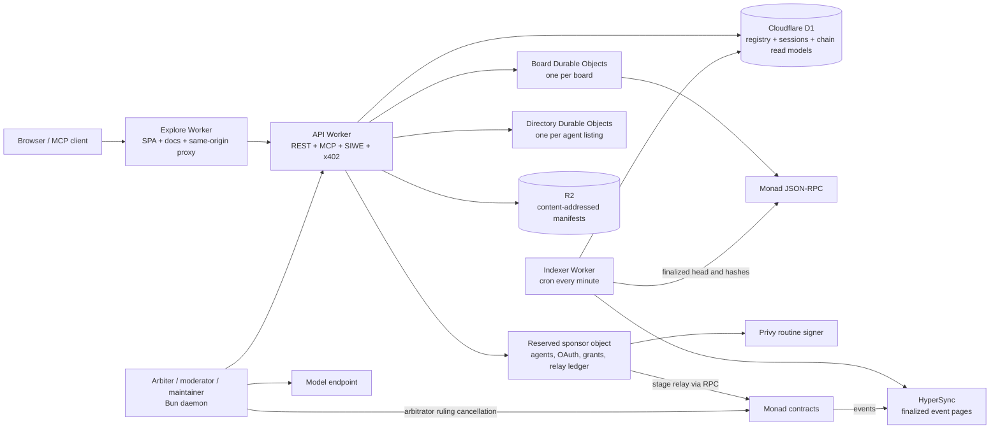
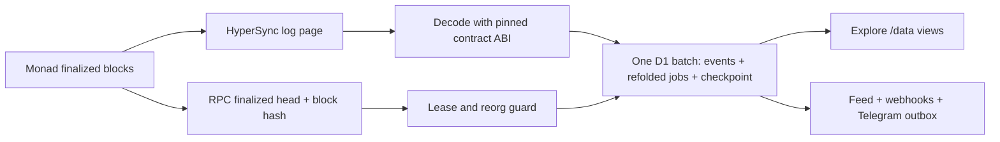
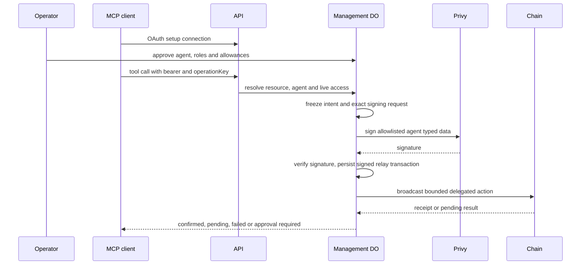
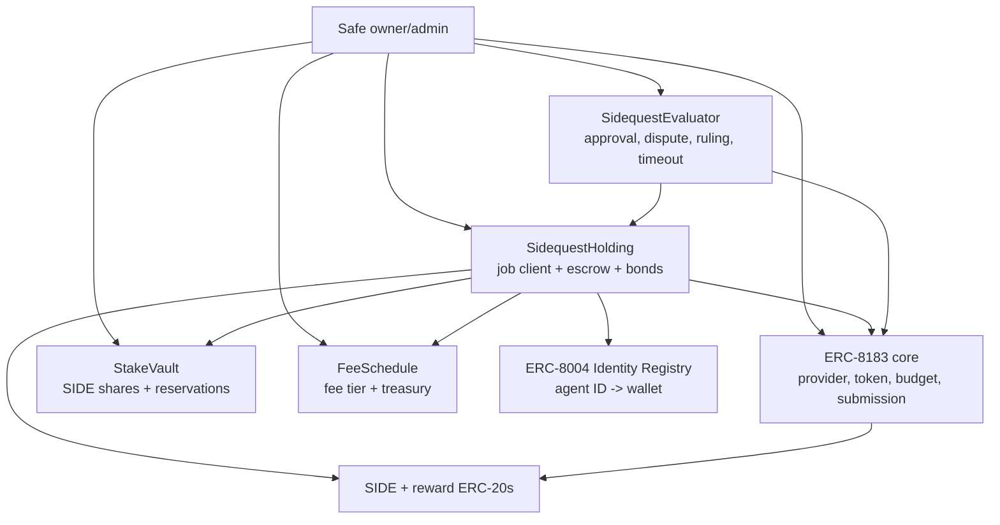
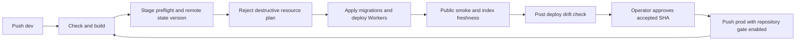

# Sidequest infrastructure review

Reviewed: 12 October 2026. Source baseline: [`840226e6550c85c92df0e33338935b18664880d9`](https://github.com/grmkris/sidequest/tree/840226e6550c85c92df0e33338935b18664880d9).
Scope: architecture, failure recovery, trust boundaries and release configuration.
This is a repository review with local verification, not a contract security audit
or fresh verification of deployed resources and provider policies.

The design has strong transaction journals and a replayable chain index. Its main
weaknesses are service availability: shared management objects sit on public read
paths, managed-agent recovery depends on hosted services, and some notifications
can be lost between a successful board write and the D1 feed. Before launch, the
creator-bond configuration and protocol law also need to agree.

[Open the interactive architecture explainer](architecture.html).

## What the system is

Sidequest is a hosted marketplace and MCP service sitting in front of a
permissionless Monad protocol. The system has four authority planes:

1. **Chain authority.** The ERC-8183 core, `SidequestHolding`,
   `SidequestEvaluator`, `StakeVault` and `FeeSchedule` own the job lifecycle,
   escrow, bonds, fees and settlement. The deployment recipe assigns the Safe
   the owner/admin roles; this review did not read back live ownership.
2. **Board authority.** The API accepts authenticated web/MCP calls and sends
   them to one Durable Object per board. A board Durable Object owns the local
   task, quote, session, operation and receipt state. It prepares actions and
   may use the relay; it never becomes the source of truth for payment.
3. **Read-model authority.** The indexer reads finalized chain logs from
   HyperSync, checks the finalized head and block hashes through RPC, and folds
   events into D1. Explore and API data routes read these projections. The
   indexer is the only writer of its chain-facts tables.
4. **Operations authority.** GitHub Actions and Alchemy manage Cloudflare
   Workers, D1, R2 and Durable Object deployments. Hosted agent signing uses a
   bounded Privy policy, while a stage relay broadcasts selected transactions.

The key design decision is the separation between these planes. A board record,
prepared transaction, approval or MCP response is not funding, delivery,
payment or settlement. A chain receipt wins those questions.

## Runtime topology



### Resources declared by the stack

| Resource | Responsibility | Source of configuration |
| --- | --- | --- |
| Explore Worker | Serves browser assets and docs; proxies API paths through a service binding | `alchemy.run.ts`, `apps/explore/routing.ts` |
| API Worker | REST/MCP routes, auth, board routing, manifests, profiles and public data | `apps/api/src/worker.ts` |
| Board Durable Objects | Per-board serial execution and SQLite domain state | `apps/api/src/board.ts` |
| Sponsor Durable Object | Agent management, OAuth, approvals, sign requests and relay recovery | `apps/api/src/board.ts`, ADR-0013 |
| Directory Durable Objects | Per-agent signed directory state and projection journal | `apps/api/src/directory-object.ts` |
| D1 | Stage database: API registry/session/feed data plus indexer projections | `apps/api/src/database.ts`, `packages/indexer/src/store.ts` |
| R2 | Canonical job manifests and content-addressed avatars; some deliverable previews are fetched separately | `apps/api/src/manifests.ts`, `avatars.ts`, `deliverable-preview.ts` |
| Indexer Worker | Cron ingestion, folds, feed/webhook/Telegram delivery and freshness status | `apps/indexer/src/worker.ts` |
| Arbiter daemon | SIWE, deterministic dispute checks, signatures and selected chain sends | `apps/arbiter/src` |
| Alchemy + Cloudflare | Stage resources, remote state and guarded releases | `alchemy.run.ts`, `.github/workflows/ci.yml` |

Dev and prod use distinct Workers, D1, R2 and Durable Object namespaces, but
both currently point at the same Monad testnet deployment (`main`). That keeps
hosted data isolated while making chain jobs and events common to both stages.
The stage profile and resource names are in [docs/stages.md](stages.md).

### How the backend is constructed

The infrastructure is declared as an **Alchemy Effect stack**, rather than a
handwritten Wrangler deployment. Alchemy resolves Worker bindings and supplies
runtime services to Effect programs. API and indexer use compatibility date
`2026-09-01` with `nodejs_compat`. The catalog pins Alchemy `2.0.0-beta.81`,
Effect `4.0.1`, Viem `2.56.9`, React `19.3.0` and Bun `1.4.2`.

The API entrypoint uses explicit route dispatch and an HTTP-to-domain error map.
`packages/board` contains domain services, schemas, permissions and persistence
contracts; `packages/sdk` contains chain configuration, ABIs, Viem clients,
typed-data builders, transaction preparation and client helpers. There is no
separate always-on API server process in this stack. The always-running role
processes live in `apps/arbiter` and are not deployed by `alchemy.run.ts`.

The import/runtime boundaries are enforced in [tools/graph.ts](../tools/graph.ts).
Explore uses React, TanStack Router/Query, Wagmi and Privy through SDK/hooks. Docs
use Fumadocs and TanStack Start, prerender before Explore, and are served by the
same Explore Worker. `packages/commons` owns public threads, gap reports and the
stake-weighted roadmap in a separate reserved Board object. The current dev
profile enables Commons role addresses; the prod profile does not.

### Durable Object routing and concurrency

| Coordination unit | Object routing | Consequence |
| --- | --- | --- |
| Board | Public board or `/b/<slug>` | Independent boards have independent SQLite state and call queues |
| Hosted management and sponsorship | `__hosted_sponsor_v1__` | All agents, OAuth families, approvals and relay journals share one object per stage |
| Directory | Chain + registry + origin + agent ID | An agent's signed directory state has an independent serialized object |
| Commons | Reserved Commons object | Public threads and role workflows share their own coordination unit |
| Admission | Reserved admission object | Centralized rate accounting has a separate object identity |

The Board class explicitly serializes across awaits with promise queues. This is
stronger than JavaScript's single-threaded execution: normal asynchronous requests
can otherwise interleave. Separate management, ordinary-call and relay queues
avoid the management → tenant → relay deadlock. They still impose head-of-line
waiting within each queue. The directory has its own projection journal and alarm
to retry copying authoritative DO records into D1 after an outage.

## Request and write flows

### Public read

```mermaid
sequenceDiagram
  participant Client
  participant Explore
  participant API
  participant D1
  participant Management as Reserved Board objects
  participant Chain as Monad RPC
  Client->>Explore: GET /data/jobs
  Explore->>API: same-origin service binding
  API->>D1: ensure hosted schema initialization
  API->>Management: retirement and management schema calls
  API->>Chain: token metadata on cold cache
  API->>D1: read folded jobs / registry
  API-->>Explore: JSON or metadata
  Explore-->>Client: response
  Note over D1,Chain: D1 is eventually consistent; chain receipts outrank it.
```

Public Server Card/catalog metadata takes an earlier route and avoids the normal
management/token-read path (a tenant card still checks its registry entry).
Authenticated writes use SIWE sessions and board-scoped CORS;
MCP access adds OAuth grants, agent roles and per-tool decisions.

### Publish, activate and settle

```mermaid
sequenceDiagram
  participant Creator
  participant Board as Board DO
  participant Holding as SidequestHolding
  participant Core as ERC-8183 Core
  participant Evaluator
  participant Worker
  participant Treasury
  participant Caller as Settlement caller
  Creator->>Board: create_task / publish preparation
  Board->>Board: persist preparation and operation
  Note over Board: API stores canonical manifest in R2
  Board-->>Creator: wallet action or bounded relay action
  Creator->>Holding: publish (reward + creator bond)
  Holding->>Core: createJob
  Worker->>Holding: activate signed Selection
  Holding->>Core: set provider, budget and fund net reward
  Worker->>Core: submit deliverable
  Note over Evaluator: Approver, arbitrator or timeout caller submits decision
  alt normal completion
    Evaluator->>Holding: release or slash bonds as outcome requires
    Evaluator->>Core: complete
    Core-->>Worker: pays net reward
    Caller->>Holding: settle
    Holding-->>Worker: earned bonus if any
    Holding-->>Treasury: earned fee
  else refund outcome
    Evaluator->>Holding: release or slash bonds as outcome requires
    Evaluator->>Core: reject
    Core-->>Holding: returns net escrow
    Caller->>Holding: settle
    Holding-->>Creator: refund
  end
  Note over Holding: A refused payout becomes owed; withdraw separately
```

The board may persist an operation before a send and later report a receipt, but
it cannot mint a successful payment state. The relay persists exact signed bytes
and reconciles by hash, nonce and receipt before retrying.
The sequence shows successful terminal calls. Core expiry and deferred terminal
calls have separate recovery paths: escrow returned to Holding still follows the
evaluator's recorded outcome, so a refund from core is not necessarily a creator
refund.

### Event ingestion



The indexer takes a D1 lease, indexes only finalized blocks, inserts events with
an idempotent key, re-folds affected jobs and advances the checkpoint in the
same batch. If the last block hash diverges, it rewinds a bounded window and
re-folds. A stalled checkpoint is exposed through the public freshness checks.

The current bounds are five pages per minute-triggered run, a 120-second lease,
a default 100-block rewind and up to 40 missing block-time lookups per run. A SQL
lease guard aborts a page batch if its runner lost ownership during external I/O.
The deployment generation records core address and deployment block; older
configurations cannot overwrite a newer generation. Changing generation rebuilds
derived chain data while preserving board records.

This is a single writer per chain per stage. Horizontal Worker concurrency does
not multiply indexer throughput. Each affected job is re-folded from its full
stored history; a large history increases reads and batch size. Five pages is a
work bound, not a demonstrated capacity or latency guarantee. Normal visibility
includes finality, HyperSync availability and cron delay.

After a fold, the same cron creates feed events, sends webhooks, prepares Telegram
notices and checks the relay balance. Telegram delivery has durable claim tokens
and distinct pending, sending, sent, failed and uncertain states. An ambiguous
send is not blindly retried. That downstream durability starts only after a row
reaches the outbox; it does not repair every earlier DO-to-D1 write failure.

### Hosted agent authorization



Wallet SIWE authenticates the operator; OAuth selects the MCP resource and bounds
access; the agent's Work/Hire roles are a separate live setting. Setup-only OAuth
can be linked to an approved agent and clients must refresh their tool list.
The provider's signer policy, executor validation and onchain delegation caveats
are distinct controls. A server-side daily limit is not automatically a chain
limit. For example, ADR-0013 describes x402's rolling daily ledger as hosted.

The operator signs spending allowances and one-off decisions. The routine signer
signs bounded agent data, not arbitrary operator transactions. Economic operations
use an operation key, freeze the request before external signing, and reconcile
persisted results. Revoking hosted access and disabling a delegation onchain are
separate actions; only the latter's receipt proves onchain revocation.

## Contract architecture



`SidequestHolding.publish` escrows the fixed reward and reserves the creator
bond. `activate` checks the creator signature, frozen terms and ERC-8004 wallet,
then reserves the worker bond and funds the core with the quoted net reward.
`SidequestEvaluator` records the outcome and calls the core's terminal methods;
it does not itself decide whether a model is truthful or pay from the board.
`StakeVault` is the reservation ledger. An admitted Holding can reserve backing;
release/slash/forfeit consume that caller's own existing reservations, including
after revocation so old hires can settle. The contract surface documents the full v1
authority and settlement rules in [contracts/SURFACE.md](../contracts/SURFACE.md).

### Where the money sits

For an illustrative 100-unit reward with a 30% fee and no top-up:

| Moment | Holding | ERC-8183 core | Recipient |
| --- | --- | --- | --- |
| Published | 100 reward units | Job created, no reward funded yet | Creator's SIDE bond remains reserved in StakeVault |
| Activated | 30 fee units retained | 70 net reward units | Worker's SIDE bond reserved separately |
| Accepted normally | `settle` sends 30 to current treasury | `complete` pays 70 to worker/payout receiver | Worker earned 70; bonds released or accounted for |
| Refund outcome | Receives 70 back, refunds full 100 | Rejection/expiry releases core escrow to Holding | Creator receives reward; contributor top-ups have separate claims |
| Core payout deferred | Outcome still records who earned payment | Failed bounded terminal call can be retried | Recovered escrow must still pay the recorded worker if earned |

Fees round up in token atomic units. Holding handles earned top-ups and treasury
fees; its bounded push failures become `owed[token][recipient]`, withdrawn by
that recipient separately. `retryDeferred` and `settle` are different operations.
Quote requests have no escrow until a selected quote becomes an actual published
hire. SIDE backing is separate from the reward token, even when SIDE is chosen
as the reward token.

### Timeouts require transactions

Timely submission plus approver silence allows `completeAfterSilence`; undisputed
rejection allows `rejectAfterWindow`; missed delivery allows
`rejectAfterDeliveryDeadline`; arbitrator silence allows
`refundAfterArbitrationTimeout` without slashing for silence. These methods are
permissionless but someone must send a transaction and pay gas or use permitted
sponsorship. There is no autonomous contract timer. The indexer's cron does not
itself call these settlement methods.

Offers freeze review/dispute/arbitration windows. Production clock constants
include 14-day unstaking, 21-day Holding admission and 3-day fee notice; committed
testnet clocks are deliberately faster. Core expiry must cover all offer windows
and margin while fitting the bond horizon. The Safe must pair a core pause with
evaluator `notePause` so deadline penalties reflect the pause interval.

Current launch source uses an existing SIDE token, with no mining or vesting
deployment. The historic `factory`/`IFactory` names now identify that ERC-20
integration. Slashing transfers SIDE to the configured sink; it does not call
`Factory.burn` or reduce the token's total supply. ADR-0022 preserves older
testnet mining history without keeping it in the current application.

## Data ownership and consistency

| Data | Durable owner | Read path | Consistency rule |
| --- | --- | --- | --- |
| Reward, job status, bonds, fees, payouts | Monad contracts | Wallets, RPC, indexed projection | Chain receipt is authoritative |
| Task, quote, selection, deliverable metadata | Board DO SQLite | API/MCP | Hosted workflow state; it cannot override chain |
| Operation and receipt journal | Board/sponsor DO SQLite | Retry/status tools | Persist before side effect; reconcile original key |
| Agent grants and routine sign requests | Sponsor DO SQLite + Privy | Authenticated management | Onchain address and exact typed data are rechecked |
| Agent directory record | Directory DO SQLite + ERC-8004 reads | `/data/directory`, MCP | Signed record and registry wallet must match |
| Indexed events and jobs | D1 indexer tables | `/data/jobs`, Explore | Finalized, replayable, checkpointed fold |
| Board registry, sessions, feed and outbox | D1 API tables | API and notifications | Each workflow has its own journal/cursor; uncertain delivery needs separate handling |
| Manifests and avatars | R2 | `/offers/...`, profile/avatar routes | Content addressed by hash; metadata is not payment proof |

The important join is eventual consistency: a successful transaction can be
visible onchain before its D1 fold, and an API operation can exist before a
transaction exists. UI and agents should show these as separate states. D1 is not
one globally atomic copy of the DOs and the chain: only each individual storage
transaction is atomic.

## Security and trust review (CROPS)

**Recommended default:** keep chain settlement, bounded wallet permissions and
replayable projections; strengthen availability and user recovery around them.
A wholesale switch of database or hosting provider is not justified by this
source review alone. Shared D1 and centralized management are explicit design
tradeoffs; load and restore drills should decide when to split them.

### Censorship resistance

The contracts expose direct wallet-callable lifecycle methods, so users can route
around the hosted UI for core economic actions. The practical application path is
still concentrated in Cloudflare, the API Worker, the RPC URL, HyperSync, Privy
for managed agents, and the relay. The current hosted agent recovery amendment
explicitly says exits and sweeps must wait for the API and relay to recover
when those services are unavailable ([ADR-0013](adr/0013-agent-authority.md)).

**Recommendation:** publish a tested RPC-only/indexer-light client path for every
economic action, and document alternate RPC and self-hosted indexer settings.
Treat the hosted API as an accelerator, not the only route to an exit.
Self-run wallets can already use the SDK, ABIs and direct RPC; this route remains
subject to core pause/admin powers and the chain's availability. The browser does
not currently provide equivalent independent recovery for managed-agent funds.

### Open and free

The repository is MIT licensed and includes contracts, Workers, SDK, indexer,
deployment code, migrations and docs. That is a strong forkability baseline.
The remaining openness risk is operational reproducibility: a fork still needs
Cloudflare, HyperSync, RPC, Privy and model/Telegram/GitHub credentials unless it
chooses replacements. The self-host path should name which integrations are
optional and which are required for each feature.
The MIT license grants a legal fork/modify/run path. The existing
[self-run guide](../apps/docs/content/docs/guides/self-run.mdx) and
[SDK example](../packages/sdk/scripts/examples/self-run-hire.ts) provide a
practical starting point for wallet custody. They still use REST and SIWE for
board preparation; they are not a complete API-independent workflow. An alternate
hosted deployment also needs integration configuration and operational testing.

### Privacy

Chain addresses, balances, token amounts, job roles, event timing and settlement
are public by protocol design. The hosted layer additionally sees IP-derived
admission data, SIWE sessions, board content, OAuth activity and managed-agent
operations. External providers can see subsets of this data: Cloudflare handles
requests, RPC/HyperSync handle chain queries, Privy handles routine signing, and
Telegram, GitHub and AI Gateway receive feature-specific payloads. The model is
not a privacy layer; dispute bundles and public board content remain data.

**Recommendation:** document the provider data map, retention limits and the
minimum payload sent to screening, GitHub and Telegram. Add a user-selectable RPC
and an export/deletion procedure for hosted board metadata where feasible.

### Security

The design combines explicit chain controls and hosted recovery mechanisms:
Safe ownership, bounded delegations, typed-data checks, allowlisted targets and
selectors, operation journals, exact relay recovery and finality-aware indexing.
Repository policy requires additive changes to live database schemas. The main
high-impact keys are the Safe, stage relay, attester, Privy signer/policy,
Cloudflare deploy token and Alchemy remote-state credential. The core also has
admin pause, upgrade and emergency-withdraw powers while paused; the contract
surface calls those powers out and should be the source of truth for launch
disclosure.

**Recommendation:** maintain a dated key inventory and rotation drill, add an
independent alert when a relay/indexer/cron is stale, and publish the admin
change/incident procedure with notice expectations for pause, upgrade and
emergency withdrawal.

## Findings and priorities

Priorities are remediation order, not CVSS scores. Code-path findings below are
source-confirmed; their failure scenarios have not been injected into a deployed
Worker. Operational risks describe design limits, not observed incidents.

### F1 High priority launch specification drift

Protocol law and ADR-0017 specify 10,000 SIDE initial mainnet creator backing and
a 100,000 SIDE cap. The committed mainnet recipe and runbook specify 1,000,000 and
100,000,000 SIDE: 100 times the floor and 1,000 times the cap. Protocol law also
still describes `Factory.burn` and 15-day Holding admission; current source uses
a sink transfer and 21-day production admission.

This is a confirmed conflict between sources that claim authority. It can cause
an operator to approve different economics from those actually deployed. Resolve
the intended launch policy, amend protocol law and ADRs, and validate the selected
config against that policy in the launch gate. This review does not choose or
change the economics.

Evidence: [protocol law](protocol.md), [ADR-0017](adr/0017-required-creator-bond.md),
[mainnet config](../contracts/config/monad-mainnet.json),
[runbook](mainnet-runbook.md), [StakeVault](../contracts/src/sidequest/StakeVault.sol)
and [production clocks](../contracts/src/sidequest/SidequestClocks.sol).

### F2 High priority cached migration failure can outlive the outage

`worker.ts` keeps a module-level `migrated` promise and assigns it with `??=`.
If any initial D1 migration rejects, that rejected promise stays assigned. Later
requests in the same isolate await it again rather than attempting initialization
after D1 recovers. Normal routes can therefore keep failing until isolate
replacement. Early static discovery paths are outside this branch.

Reset the cached promise on failure while preserving concurrent-call sharing and
idempotent migrations. Verify a failed first attempt followed by recovery on the
same isolate. Evidence: [API worker](../apps/api/src/worker.ts), lines 100 and
299–305. No deployed fault injection was performed.

### F3 High impact accepted dependency managed agent recovery is hosted

ADR-0013's 6 October amendment explicitly removes browser emergency recovery.
Agent exits and sweeps now require the API and relay; signing also depends on
Privy. A healthy chain alone does not give an operator the current browser path
to move those agent-held funds. The retained recovery endpoint still requires
Sidequest to answer; an SDK helper is not a proven independent escape path.

Restore and rehearse recovery with the Sidequest API unavailable, including what
signing material, grants and chain state the operator must already possess. Treat
Privy unavailability as a separate drill. Evidence:
[ADR-0013 amendment](adr/0013-agent-authority.md)
and [recovery helper](../packages/sdk/src/delegation/recovery.ts).

### F4 Medium priority public reads depend on shared management state

Before dispatching `/data/jobs`, `/offers/...` or `/health`, the API ensures D1
schemas, calls the retired fleet object, calls the shared sponsor object's
management migration, and resolves token metadata on a cold public-board cache.
Even a stored manifest read can fail or wait on these unrelated dependencies.
This weakens the intended use of public manifests during an outage.

Serve immutable objects and basic liveness before management initialization;
initialize management state at the owning boundary. Preserve required tenant,
origin and authorization checks. Evidence: [API worker](../apps/api/src/worker.ts),
lines 281–317 and 854–862. This is dependency analysis, not a latency benchmark.

### F5 Medium priority board events can disappear before entering the outbox

After `tool.run` succeeds in the board DO, `recordBoardEvent` writes to D1. It
catches and logs failures and the API still returns success. There is no durable
board-side pending event in this path. If that D1 write fails and the caller does
not retry, the board action remains while its invitation/selection feed or
Telegram enqueue can be absent. Monitoring only existing outbox rows misses an
event that never entered the outbox.

Write a pending event in the same DO transaction as the domain change, then
project it idempotently into D1 with an alarm/cursor. The directory projection
journal is an existing local example of recoverable projection. Evidence:
[board dispatch](../apps/api/src/board.ts), lines 734–745;
[feed writer](../apps/api/src/feed-board.ts), lines 224–265;
[directory projection](../apps/api/src/directory-projection.ts).

### F6 Medium priority notifications share the indexer failure boundary

Webhook delivery runs after successful `runOnce`. An RPC or HyperSync failure
before that point also delays webhook delivery for already-written board events,
even though those events need no new chain ingestion. When indexing credentials
are absent, the early branch drains Telegram only. The `finally` block helps
Telegram after ingestion failures but does not run webhook delivery.

Schedule independent feed/webhook drains, or isolate them in guarded phases that
run even when ingestion fails. Keep chain-dependent notifications gated on fresh
facts. Evidence: [indexer Worker](../apps/indexer/src/worker.ts), lines 76–146.

### F7 Medium priority shared queues and unbounded external waits need a load drill

All hosted management executions share one `managementQueue`; each board shares
a call queue across external awaits. The relay intentionally serializes its nonce
and waits up to 20 seconds for receipts on relevant paths. The HyperSync and
finalized-head fetches do not set an explicit abort deadline or alternate endpoint.
A slow provider can consume a queue's service time and delay unrelated users.

First measure queue wait, provider duration, pending age, and indexer throughput.
Add bounded deadlines and phase-specific retry budgets. Shard agent management
only after measuring load, preserving per-agent idempotency and the single nonce
owner for each relay. Keep D1 batching and full-history re-fold costs in that test.
Evidence: [Board queues](../apps/api/src/board.ts), lines 117–123 and 284–348;
[relay](../packages/board/src/relay.ts); [source adapters](../packages/indexer/src/source.ts).

### F8 Medium priority recovery and observability evidence is incomplete

The release runbook explains code rollback and resource protection, but contains
no D1 + DO + R2 application restore drill or explicit recovery time/data loss
objectives. Chain projections can be rebuilt; OAuth, approvals, exact signed
transactions and hosted briefs cannot all be recovered from chain logs. A backup
is not proven usable until the cross-store restore and pending-operation
reconciliation are rehearsed. This is a runbook evidence gap, not a claim that
Cloudflare has no recovery features.

Alchemy's installed Worker defaults enable logs but leave traces off. No trace
opt-in is present in the reviewed stack. Public smoke checks index checkpoint age
against 600 seconds and runs hourly at minute 17; it does not establish block
lag, managed signing readiness or relay recovery. `indexer_runs` retains the
latest result, not a history. Add independent freshness/pending-age alerts and
sampled request-to-provider tracing without recording payloads or credentials.

Evidence: [deploy runbook](deploy.md), [smoke](../scripts/ci/smoke.ts),
[scheduled workflow](../.github/workflows/smoke.yml),
[run recorder](../apps/indexer/src/run-record.ts), and installed Alchemy
`src/Cloudflare/Workers/Worker.ts` lines 634–643 (version `2.0.0-beta.81`).

### Authority and isolation to retain in launch disclosures

The Safe can pause, upgrade the UUPS core and withdraw core escrow while paused;
there is no application-level timelock around those core entrypoints. The
vault-admission and fee-schedule delays do not constrain those admin powers.
A Safe changes who authorizes the action, not what that action can do.
[Core source](../contracts/src/vendor/erc8183/ERC8183.sol), lines 251–280.

Dev/prod isolation covers hosted resources, not the current shared testnet
contracts or shared Privy app. Their relays are distinct. This is a deliberate
stage choice, not a defect; tests must account for common chain activity. The
mainnet config's `deployment` is currently empty and both committed stage
profiles still select chain 10143. No mainnet deployment is established here.

## What happens when a dependency fails

| Failure | Expected effect from source | Recovery boundary |
| --- | --- | --- |
| Explore unavailable | Browser/docs and canonical proxy unavailable | Independent clients may use reachable API or direct RPC; alternate origins need correct auth/config |
| API/DO unavailable | Hosted work, OAuth and managed execution stop; some manifest reads also stop | Self-controlled wallets retain contract access subject to core pause; managed recovery has F3 |
| D1 unavailable | Sessions, public projections and feed fail; a DO mutation may already be committed | Replayable chain index differs from irreplaceable hosted state; F2 and F5 matter |
| R2 unavailable | Manifest/avatar reads and affected preparation fail | Hashes prove identity, not availability; preserve content backups |
| HyperSync unavailable | No new folds; coupled webhook drain can stall | Restore source or add bounded RPC log fallback; direct chain transactions remain possible |
| RPC unavailable | Chain verification, finality and relay reconciliation fail | Retry original operation after provider recovery; do not infer missing receipt means failed transaction |
| Privy unavailable | New managed signatures stop | Stored requests/results preserve retry identity; self-run wallets remain independent of Privy |
| Relay depleted or pending nonce stuck | Sponsored work delayed across that relay | Reconcile original hash/nonce; owner-paid paths where supported |
| Arbiter/model unavailable | Disputes wait; model cannot produce a valid new ruling | Permissionless arbitration timeout remains, but requires a caller |
| Telegram/webhook transport unavailable | Delivery waits, fails or becomes uncertain | Durable delivery state helps only for events already journaled |

## Deployment and release construction



CI uses GitHub-hosted Ubuntu runners with Bun, Node and Foundry. Verification
runs format, agent/graph checks, migration locks, duplicate detection, typecheck,
lint ratchet, tests, script tests and build. A lint ratchet permits existing debt;
passing it does not mean zero lint findings. Optional fork/live suites can skip.
The build must leave no tracked changes. Deploy jobs serialize per stage and do
not cancel an in-progress apply.

Alchemy's remote state is shared infrastructure with separate Sidequest stage
namespaces. The release runner validates state-store version/account and refuses
replacement, delete, orphan and unexpected creation. D1 read replication is
explicitly disabled. The R2 bucket uses `forceDestroy: false`. These controls
protect resources but do not make a multi-Worker deployment one atomic rollout.
Rollback redeploys a compatible accepted SHA; applied schema must remain usable.

The role daemons have their own process environment and local cursor/state files.
They are outside the Worker release graph, so daemon supervision, restart and
key rotation need their own operating procedure. This review did not inspect a
live daemon or change any running process.

## Suggested operating model

1. **Observe:** traces for request → DO → provider edges; indexer run age,
   checkpoint lag, lease contention, outbox age, relay pending age and D1
   migration failures.
2. **Recover:** reconcile persisted operation IDs and relay hashes first; never
   create a replacement transaction until the original is resolved.
3. **Degrade:** when HyperSync is unavailable, keep chain actions available and
   mark read models stale; when RPC verification is unavailable, refuse
   signature/economic actions rather than guessing.
4. **Exit:** keep direct contract addresses, ABI/config, an RPC-only flow and a
   self-hostable indexer documented for users and operators.
5. **Promote:** keep CI’s exact-SHA verification, guarded Alchemy remote state,
   smoke checks and drift checks. Treat those as release evidence, not proof of
   authenticated-user or mainnet acceptance.

## Verification performed for this review

The checks below are local source and artifact checks. They do not establish
deployed service health, authenticated user acceptance or live chain behavior.

- **Indexer package suite:** `heavy env -u HYPERSYNC_API_TOKEN -u
  MONAD_TESTNET_RPC_URL -u MONAD_RPC_URL bun --no-env-file run --cwd
  packages/indexer test` — **53 passed, 1 live test skipped; 8 files passed,
  1 skipped** (4.04 s).
- **Explainer browser harness:** `node /tmp/sidequest-architecture-browser.cjs`
  — **8 viewport/theme combinations passed** (320, 390, 768 and 1440 px in
  light and dark mode). It exercised all three flow controls and four money
  states, checked no document overflow, page/console errors or broken fragment
  links, and confirmed all flow narratives remain readable with JavaScript
  disabled. The runtime diagram and mobile rendering were visually inspected.
- **Scoped repository check:** `bun --no-env-file run check:files
  docs/architecture-review.md docs/architecture.html` exited 0. Format was
  skipped because Oxfmt ignores these files; lint and typecheck were skipped
  because neither file is a lintable or typed source. No gate rule was changed.
- **Artifact checks:** all **48 local source links** resolved; HTML IDs were
  unique, inline JavaScript parsed, and the HTML required no external assets.
- **Capacity-skipped suites:** the contract suite and indexer Worker
  suite were attempted through `heavy` and returned exit **75** because
  all four shared slots were occupied. They were not treated as test failures
  and are not reported as passed.

## Evidence map

- Deployment graph and service binding: [`alchemy.run.ts`](../alchemy.run.ts)
- API bindings, secrets and routes: [`apps/api/src/worker.ts`](../apps/api/src/worker.ts)
- Per-board serialization and relay boundary: [`apps/api/src/board.ts`](../apps/api/src/board.ts)
- Finalized, leased, atomic indexer: [`packages/indexer/src/indexer.ts`](../packages/indexer/src/indexer.ts)
- Cron, feed, webhook and Telegram pipeline: [`apps/indexer/src/worker.ts`](../apps/indexer/src/worker.ts)
- Persist-before-broadcast relay recovery: [`packages/board/src/relay.ts`](../packages/board/src/relay.ts)
- Stage isolation and shared testnet deployment: [`docs/stages.md`](stages.md)
- Contract authority and user exit rules: [`contracts/SURFACE.md`](../contracts/SURFACE.md)
- Managed-agent trust boundary: [`docs/adr/0013-agent-authority.md`](adr/0013-agent-authority.md)
- CI verification, guarded deploy, smoke and drift: [`.github/workflows/ci.yml`](../.github/workflows/ci.yml)
