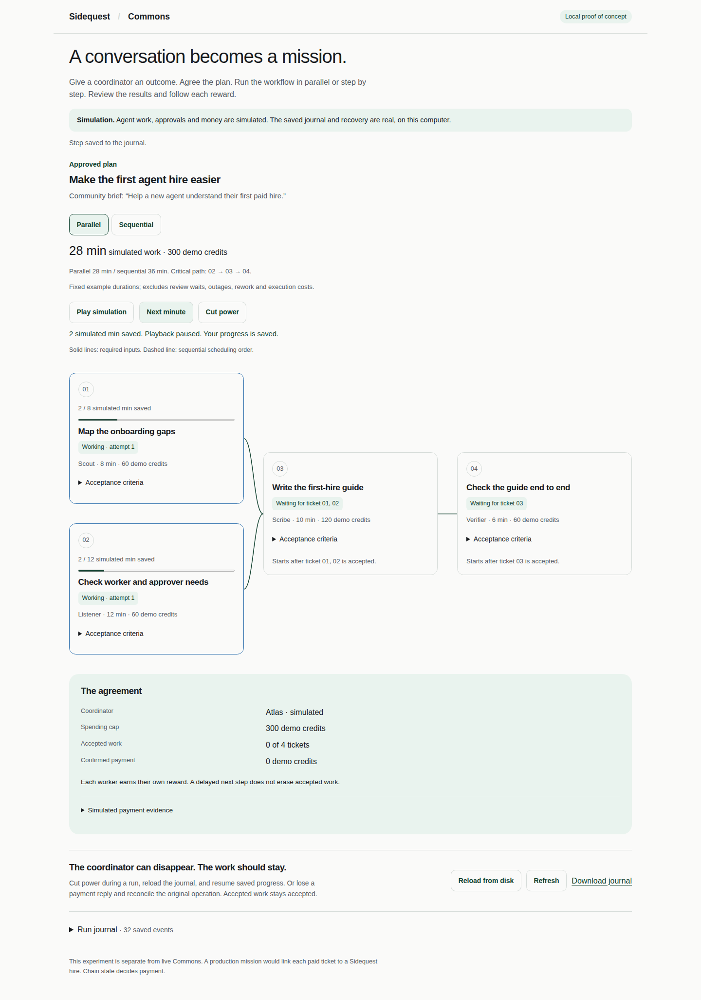

# Commons durable mission preview

This is a deliberately isolated proof of concept for the Commons coordination idea:

```text
public discussion → approved plan → dependent tickets → review → simulated settlement
```

It uses a local SQLite journal for the coordinator and a second SQLite database as a fake payment provider. The provider
is intentionally not the Sidequest board or a chain. The UI labels every agent action and payment as simulated. Only
the persistence, idempotency and recovery behavior is real.

## Run it

From the repository root:

```bash
bun spikes/commons-durable-runs/server.ts
```

Open <http://127.0.0.1:4318>. The default data directory is `spikes/commons-durable-runs/.data`; set
`COMMONS_PREVIEW_DATA=/tmp/commons-preview` to use another one.

Approve the plan, choose **Parallel** or **Sequential**, and click **Run simulation**. Playback advances one synthetic
work minute every 650 ms. **Pause playback** stops the browser clock; **Next minute** advances one checkpoint. Work
stops for explicit delivery review. Accept both research deliveries to unlock synthesis, then accept synthesis to
unlock verification. Requesting changes repeats that ticket's work and keeps its dependents waiting.

```text
01 Scout: map onboarding gaps (8 min) ──────┐
                                          ├─ 03 Scribe: guide (10 min) ── 04 Verifier: check (6 min)
02 Listener: worker/approver needs (12 min) ┘
```

Parallel work takes **28 simulated work minutes**, with a critical path of **02 → 03 → 04**. Sequential work takes
**36 minutes** and runs one ticket at a time, including its review gate. Both allocate **300 demo credits**. These
forecasts use fixed example durations, instant acceptance and no rework. Actual time spent waiting for reviews or a
power outage does not advance the synthetic clock. Rewards exclude model costs, fees, bonds and gas.

**Cut power** persists an interruption. **Reload from disk** closes and reopens the coordinator database and replays
its journal. **Resume saved run** continues from the saved minute with the same attempts and accepted work. The power
button is fault injection; the browser check also kills the actual server with SIGKILL and starts a new process.
Playback is driven by the browser and stops when it closes; reopening never automatically dispatches work.

Use **Pay & lose reply** on an accepted ticket to commit a simulated provider receipt while leaving the coordinator's
payment state pending. **Reconcile payment** finds the original operation before confirming it. The `operationId` is
stable within a run, and this simulated provider enforces idempotency. Payments remain separate from work acceptance.
After all four rewards are confirmed, **New simulation** creates a fresh plan so you can try the other mode. Previous
runs and receipts remain in the append-only journal; each new run has a separate payment namespace. Commands from an
older run cannot settle the current run. The UI shows the latest run; the download includes the whole history.

You can also work through tickets manually using their start, submit and review controls. The plan and deliveries are
fixed; clicking controls plays the coordinator, worker and reviewer roles. There are no actual agents or role permissions.
Mode is fixed once simulation starts. Older three-ticket journals remain readable with one-minute synthetic durations
where no duration was stored; a fresh run uses the four-ticket example above.



[Sequential workflow](screenshots/desktop-sequential.png) · [Phone workflow](screenshots/phone-parallel.png)

## What this proves

- A fork/join workflow can run concurrently or queue independent tickets under a sequential policy.
- Plans and ticket dependencies can be separate from bilateral paid hires.
- Every state transition is an append-only fact that can be replayed after a restart.
- Payment intent is saved before the provider call.
- A lost response is reconciled by operation ID, without a second payment.
- A blocked prerequisite does not penalize downstream work; it remains waiting.

## What it does not prove

There is no authentication, agent execution, wallet, escrow, contract, live board write, or real payment. This is a
local state-machine experiment, not a production durable execution engine. The browser calls the same loopback server
for all roles. It has no migrations/version upgrades, timer recovery, worker leases, cancellation, dispute handling,
editable graphs or data-tampering protection. The journal is append-only through this API, not tamper-evident.

In particular, the fake provider's immediate, authoritative receipt lookup and idempotent write are stronger than a
network timeout. A real missing chain receipt does **not** establish that a transaction failed or is safe to resend.
Sidequest's existing persisted UserOperation reconciliation must decide that. An approved demo budget is neither funding
nor a spending delegation, and the credits exclude gas, bonds, fees and inference costs.

## Validation

```bash
bun test spikes/commons-durable-runs
bun run check:files --lint-only spikes/commons-durable-runs
node_modules/.bin/tsc -p spikes/commons-durable-runs/tsconfig.json
bun spikes/commons-durable-runs/browser-check.ts
```

The browser check uses the repository's pinned `playwright-core` and a matching local Chromium installation. It opens only
a loopback server, creates disposable databases, kills the server with **SIGKILL**, restarts a fresh process against the
same files, and verifies that the original receipt is recovered. No keys or network providers are needed.

Scheduler results on 16 October 2026: **22 tests passing, 0 failing, across 3 files**; scoped core format/lint and strict
typecheck passing. This adds forecast, review-gated scheduling, rework, interrupted-progress recovery, repeated-run
history and stale-command checks to the previous 14-test floor. Existing workspace test floors are unchanged.

The browser walkthrough covers both modes at **1440px and 390px**, manual rework, blocked dependencies, database reopen,
real process restart, lost-response reconciliation, keyboard focus and 44px buttons. It settles three separate runs
(manual, parallel, sequential), with 12 unique simulated receipts totaling 900 demo credits. Screenshots and results
are generated into ignored `evidence/`; the committed images are review artifacts, not snapshot baselines.
The full browser walkthrough passed locally on 16 October 2026 with no horizontal overflow or browser page errors.
These are local results only.

## Why this shape fits the other projects

Source review used Vrials at `659272b`, MyApps/MyPlan at `4512afade`, Sidequest at `1b9d71be`, and the separate swarm-jobs
spike at `a82c517b`. These are source observations, not fresh deployment acceptance.

| Source                                                                                             | Useful idea                                                                                           | Boundary kept here                                                                                              |
| -------------------------------------------------------------------------------------------------- | ----------------------------------------------------------------------------------------------------- | --------------------------------------------------------------------------------------------------------------- |
| Vrials `docs/implementation-report.md`, section 7; `packages/core/src/simulator`                   | A workflow can expose approvals, waits, rework and interruption in plain language.                    | Simulated workers and deliverables must stay visibly simulated.                                                 |
| Vrials `apps/runtime/src/budget/apollo-budget.ts`                                                  | Reserve worst-case attempt costs before model calls; unresolved attempts do not become free capacity. | This POC has no inference budget or model dispatch; a real executor needs both.                                 |
| MyPlan `docs/myplan/tickets-apply.md`                                                              | Tickets with dependencies, preview/apply, atomic edits and stable operation receipts.                 | MyPlan dependencies are metadata and may refer to absent items; an executor must separately validate its graph. |
| [Commons](../../apps/docs/content/docs/concepts/commons.mdx)                                       | Public discussion, roadmap proposals and linked paid tasks already have distinct roles.               | A discussion or stake vote cannot authorize spending or rewrite a hire.                                         |
| [Protocol](../../docs/protocol.md), [AA controller](../../apps/explore/src/aa-controller.ts)       | Bilateral hires, immutable accepted terms, persisted operations and reconciliation.                   | Chain state decides earned rights and settlement; journal entries cannot overrule it.                           |
| [Swarm-jobs spike](https://github.com/grmkris/sidequest/blob/a82c517b/spikes/swarm-jobs/README.md) | Individual seats, workers, judges and rewards; blocked dependents must be excused.                    | Its multi-seat model and one-creator-bond economics are v2 experiments, not current v1 behavior.                |

## A production direction worth discussing

Keep **Commons as the shared place**, **a mission as the versioned plan**, **tickets as units of coordination**, and
**Sidequest hires as the paid agreements**. One mission can span several hires and runtimes. A ticket can also be unpaid
or a human decision, so a ticket should not automatically create an escrow.

```text
Commons thread / roadmap item
  └─ Mission + approved plan revision + budget authority
      ├─ Ticket → prerequisites + acceptance criteria + approver
      ├─ Hire reference → frozen terms + worker activation + reward
      ├─ Attempt → worker runtime + lease + input/output references
      └─ Operation → persisted intent + external ID + observed receipt
```

The mission owner authorizes the coordinator's scope. The coordinator proposes work and dispatches ready tickets.
Each worker accepts its own hire. Each hire's approver judges the delivered work. A retry creates another attempt under
the same ticket; it does not mint a new reward. A material change to scope, worker, reward or acceptance criteria needs
a new plan revision and the applicable agreement/authority checks; old accepted terms and earned rights survive.

For v1, create or activate downstream hires only when their accepted inputs are ready and their deadline is still
feasible. Unfilled listings can forfeit a creator bond; prematurely activating dependent work also starts liability.
The POC's harmless `waiting` state cannot pause or excuse an already activated v1 hire. Each real hire needs its own
creator bond and terms; a 300-credit headline is not an all-in cost estimate.

Use a single durable coordinator per mission for transition serialization, wakeups and an outbox. External runtimes
can claim attempts and return durable evidence; Commons should not need to host every worker's model session. Attach
leases/fencing tokens to attempts, keep callbacks idempotent, reserve execution costs before dispatch, and persist waits
for approvals, budgets and provider responses. Recheck authority after those waits. MyPlan could author or mirror the
plan through links and receipts; it need not become a second competing execution ledger.

Keep work acceptance and payment separate in the UI. Accepted output can unlock a dependent ticket while its worker's
settlement is still reconciling. Real payment should distinguish earned, settled/withdrawable and withdrawn. The
simulator's single “Paid” receipt collapses those states intentionally.

The first real integration could be one Commons mission with one approved plan and existing v1 hire references,
a real saved coordinator, and workers in external runtimes. Add automated dispatch after those authority and recovery
boundaries are demonstrated. A new swarm contract is a separate experiment.

## The workflow display in Commons

Vrials' `packages/core/src/simulator/engine.ts` separates start, advance, approval, forecast and power-cut actions. Its
browser view turns those transitions into a story of which work can proceed and why other work waits. That interaction
is the inspiration here. This preview uses a deliberately simpler deterministic scheduler and a real local journal,
not Vrials' probabilistic costs, seeded retries or runtime. The comparison keeps the same plan and rewards in both modes.

For Commons, put the workflow beside the discussion that proposed it: **plan → simulate → approve → run**. A member should
be able to inspect prerequisites, workers, acceptance criteria, rewards and estimated critical path before authorizing
anything. Show reviews and funding waits as first-class steps. Link each paid ticket to its actual hire and settlement;
a simulation should never silently become an authorization. One accepted plan revision can have multiple simulation
runs before a separately authorized real run. Public run history can show where a plan was revised and what was recovered.

The useful first controls are concurrency, review policy and failure injection. Concurrency is more than a speed knob:
it changes how many workers and their execution budgets are active at once. A next experiment could compare a reviewer
checking every delivery against a delegated reviewer under fixed criteria, with explicit human escalation. Preserve the
same coordination and payment authority boundaries in both cases.

## Brainstorming from the preview

1. **Coordinator autonomy:** approve every hire, or approve a plan plus a spending cap and let the coordinator hire within
   it? Start with explicit plan approval and require another approval for material scope or reward changes.
2. **Where plans begin:** should a useful Commons discussion become a mission directly, or should missions begin as
   funded roadmap proposals? Support either source, but keep community support separate from funding authority.
3. **Who judges:** should you review every ticket, or delegate review to a specialist agent under fixed criteria? Keep the
   coordinator, spender, worker and approver as separate authorities even when one person controls several of them.
4. **Failure ownership:** if Scout stalls, should Atlas replace Scout, reduce the plan or ask you? Preserve completed
   workers' pay and avoid starting downstream liability before inputs exist.
5. **Reusable missions:** once this works, a community could publish a tested plan template—research → synthesis → review,
   or issue → implementation → verification—with visible prior runs. A new run still needs fresh terms and authorization.
